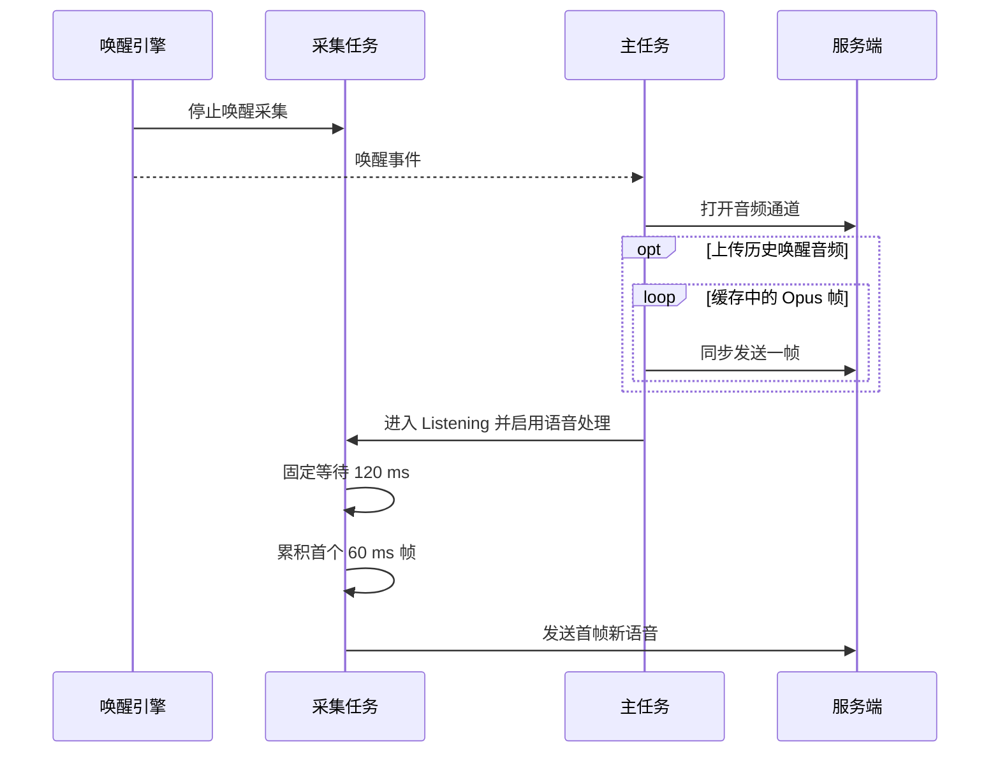

# XiaoZhi ESP32 音频链路延迟与音质分析报告

审查日期：2026-10-22。源码基线：`90ad1e9`。审查方式：静态阅读当前仓库源码和已有音频、协议文档；未修改固件，未运行构建或设备测试。

**审查结论：需要修改。** 当前的采集、Opus 编解码和播放任务已分开，音频队列也有容量限制，但唤醒后采集断档、TTS 首帧时序、主任务同步发包和 UDP 丢帧处理仍会影响响应速度与语音完整性。优先保证首尾语音不丢失、控制事件不被音频发送阻塞，再按板卡和网络实测结果调整帧长与音频处理参数。

## 范围与结论边界

本报告覆盖 `main/application.*`、`main/audio/`、WebSocket 与 MQTT/UDP 音频协议，以及 ESP32-S3 Box Lite 的软件播放参考。已有的[音频架构说明](../main/audio/README.md)和[输入通道审计](audio-codec-input-audit.md)用于理解板卡差异。报告中的“已确认”指源码控制流或并发关系可以直接证明；运行时触发频率、实际毫秒数、听感和 ASR 准确率仍需设备实测。

例如，默认 60 ms Opus 帧意味着从空缓冲区凑齐首帧需约 60 ms，启用语音处理还设置了 120 ms 的采集等待。这两个代码常量相加可作为首包路径的估算，**不能当作端到端实测延迟**。服务端 ASR、LLM、TTS、网络往返、AFE 和扬声器实际出声时间尚未计入。

## 当前关键路径

下图展示唤醒后的源码顺序。历史唤醒音频上传仅在 `CONFIG_SEND_WAKE_WORD_DATA` 开启时执行；即使关闭该选项，连接期间的实时采集仍未在此路径启动。



这条路径对应证据 E-001、E-002 和 E-003，以及发现 F-001。图中的时间只表示代码中的固定等待和组帧长度；连接、编码、发送和调度时长均未测量。

## 上轮观点复核

| 观点 | 复核结果 | 证据与限制 |
| --- | --- | --- |
| 60 ms 帧导致组帧等待 | **成立**，默认上行帧长为 60 ms；改成 20 ms 最多减少约 40 ms 的单次组帧等待，同时使相同媒体时长的包数变为三倍。 | E-001；4G 模组每包发送成本未知，不能直接推断端到端收益。 |
| 上行队列可积压 2.4 秒 | **容量计算成立**：40 包 × 60 ms。它是极端情况下允许排队的媒体时长，不是正常响应延迟。 | E-001、E-005；队列满时会丢最旧包。 |
| 下行队列为 1.2 秒 | **只在服务端也是 60 ms/包时成立**：20 包 × 60 ms。服务端可协商其他帧长；例如 20 ms/包时仅对应 400 ms。 | E-001、E-006、E-007。 |
| 启用 FEC 可解决 TTS 断音 | **不能单独成立**：当前 `enable_fec=false` 是设备上行编码设置。下行是否能用 FEC 取决于服务端编码、下一包是否到达以及设备端恢复逻辑。 | E-001、E-006。 |
| 每帧分配内存是主要瓶颈 | **证据不足**：代码存在按帧构造对象和缓冲，但没有 CPU、堆碎片或任务调度实测。 | 在消除确定性断档与丢帧后再剖析。 |

## 证据清单

全部证据来自上述源码基线，编号供发现和路径追溯。链接中的行号用于定位；附录提供可重复执行的只读命令。

| 证据 | 源码观察 |
| --- | --- |
| E-001 | [音频常量和编码配置](../main/audio/audio_service.h#L40)：上行 60 ms、上行发送队列 40 包、下行接收上限 20 包；Opus 编码为 `AUDIO`、复杂度 0、上行 FEC 关闭、DTX 请求开启。 |
| E-002 | [唤醒回调](../main/audio/audio_service.cc#L96)清除唤醒采集事件；[AFE 唤醒处理](../main/audio/engines/afe_audio_engine.cc#L473)也关闭唤醒检测；[启用语音处理](../main/audio/audio_service.cc#L713)设置采集等待标志，随后[采集任务](../main/audio/audio_service.cc#L276)等待 120 ms。 |
| E-003 | [唤醒连接流程](../main/application.cc#L947)先编码历史音频并打开通道，随后在[主任务循环发送历史帧](../main/application.cc#L991)，最后进入 Listening；[实时采集启动](../main/application.cc#L1152)发生在 Listening 状态处理。 |
| E-004 | [TTS `start` 处理](../main/application.cc#L632)把 Speaking 状态切换排入主任务；[接收音频回调](../main/application.cc#L567)只在 Speaking 时入队；[Speaking 处理](../main/application.cc#L1059)随后重置并清空解码队列。 |
| E-005 | [主任务发送循环](../main/application.cc#L245)持续取包发送，排在唤醒及调度事件之前；[MQTT/UDP 发送](../main/protocols/mqtt_protocol.cc#L204)明确注明模组发送可能阻塞。 |
| E-006 | [UDP 接收](../main/protocols/mqtt_protocol.cc#L332)拒绝迟到序号且对缺口继续处理；[解码调用](../main/audio/audio_service.cc#L413)使用 `ESP_AUDIO_DEC_RECOVERY_NONE`。 |
| E-007 | [解码队列](../main/audio/audio_service.cc#L609)满时直接返回 `false`；[应用接收回调](../main/application.cc#L567)未检查该返回值；[服务端帧长](../main/protocols/mqtt_protocol.cc#L426)可由 `hello` 更新。 |
| E-008 | [Box Lite 采集侧](../main/boards/espressif/esp32-s3-box-lite/box_audio_codec_lite.cc#L212)读参考数组和位置；[播放侧](../main/boards/espressif/esp32-s3-box-lite/box_audio_codec_lite.cc#L243)修改相同数组和位置并执行 `memmove`，两侧未见同步。该参考由[板级配置](../main/boards/espressif/esp32-s3-box-lite/config.h#L9)控制。 |
| E-009 | [解码器重配](../main/audio/audio_service.cc#L532)释放互斥锁后重新打开并写入 `opus_decoder_`；[解码器重置](../main/audio/audio_service.cc#L802)在另一条主任务路径持锁访问同一对象。 |
| E-010 | [WebSocket 二进制接收](../main/protocols/websocket_protocol.cc#L108)在 v2/v3 分支直接读取结构体和声明的 payload 长度，没有先比较实际回调长度 `len`。 |
| E-011 | [AudioCodec 输入接口](../main/audio/audio_codec.cc#L21)把实际读取样本数压缩为布尔值；[音频服务](../main/audio/audio_service.cc#L195)继续使用预设长度的向量。部分 codec 会[返回实际读取数](../main/audio/codecs/no_audio_codec.cc#L241)。 |
| E-012 | [AFE 配置](../main/audio/engines/afe_audio_engine.cc#L133)使用低开销 AEC、`VERYAGGR` NLP，关闭 NS；[厂商 Opus 头文件](../managed_components/espressif__esp_audio_codec/include/encoder/impl/esp_opus_enc.h#L91)说明 DTX 生效要求 `VOIP` 应用模式。 |

## 发现与影响

优先级根据用户可见的语音损失、控制延迟与稳定性排序；“高置信”表示源码因果链明确，并不表示现场已复现。

| 发现 | 优先级 / 置信度 | Evidence | 影响与触发条件 |
| --- | --- | --- | --- |
| F-001 唤醒后实时采集断档 | P0 / 高 | E-001、E-002、E-003 | 连接和可选的历史音频串发期间尚未开始实时语音处理；用户紧接唤醒词说话时，开头可能未被采集。启用处理后另有固定 120 ms 等待。 |
| F-002 TTS 首帧与重置竞态 | P0 / 高 | E-004 | 首帧可能在 Speaking 状态生效前被拒绝，也可能入队后被状态处理清除。MQTT 控制和 UDP 音频分路时更易遇到交错。 |
| F-003 上行发送阻塞控制路径 | P0 / 高 | E-001、E-005 | 发送速率低于产包速率时，主任务可能长时间无法处理唤醒、调度与状态事件；队列满后旧语音被丢弃。实际阻塞时长待测。 |
| F-004 下行乱序、缺帧和静默丢弃 | P0 / 高 | E-001、E-006、E-007 | UDP 小幅乱序会丢迟到包；缺包没有明确的定时补偿；解码队列满时新 TTS 包被拒绝且应用不计数，表现为缺字或卡顿。 |
| F-005 Box Lite 软件参考并发访问 | P0 / 高 | E-008 | 使用软件参考的板级路径中，读写位置和数组发生数据竞争；可能使 AEC 参考错位，极端交错下存在内存访问风险。需限定到启用该参考的配置。 |
| F-006 解码器生命周期未统一受锁保护 | P0 / 高 | E-009 | 服务端采样率或帧长变更与状态重置交错时，可能出现解码器指针和配置竞态。 |
| F-007 WebSocket 二进制帧未完整校验 | P0 / 高 | E-010 | 截短或伪造长度的 v2/v3 帧可能触发越界读取或异常分配，影响播放与设备稳定性；须先验证实际帧长再复制。 |
| F-008 采集短读可能被当作整帧 | P1 / 高 | E-011 | 当底层返回正数但少于请求样本数时，上层仍按预设向量长度处理，未读取部分可作为静音样本进入语音链路。是否发生短读需硬件计数。 |
| F-009 编码和 AFE 音质参数待标定 | P1 / 中 | E-001、E-012 | 复杂度 0、`AUDIO` 模式、请求 DTX 与厂商 DTX 生效条件不一致；激进回声后处理与关闭 NS 的听感由麦克风、扬声器和环境决定。不能仅凭配置推断实际音质。 |

### 关键 Evidence → Finding → Path 链

- **P-001，唤醒到上行首包（调用路径）：** 唤醒引擎停止唤醒采集（E-002）→ 主任务建立通道并可选串发历史音频（E-003）→ 进入 Listening 后设置并执行 120 ms 等待（E-002）→ 累积默认 60 ms 帧（E-001）→ 首帧新语音可发送。该路径支持 F-001；连接和模组发送时间尚无测量。
- **P-002，TTS 首帧（调用路径）：** 收到 TTS `start` 后仅排入状态任务（E-004）→ 音频回调按当前 Speaking 状态决定入队（E-004）→ 状态处理重置队列（E-004）。根据两个回调的交错，首帧可能在入队前或入队后丢失，支持 F-002；是否频繁触发需事件时序日志。
- **P-003，UDP 下行缺帧（数据路径）：** 序号跳跃被记录但继续处理新包（E-006）→ 迟到包因序号较小被拒绝（E-006）→ 未请求解码恢复（E-006）→ 队列满时新的音频包可能被拒绝且未记录（E-007）。该路径支持 F-004；真实丢包率和听感待测。

## 推荐的修复顺序

### 1. 先保证采集与播放会话完整

在唤醒回调后继续采集，将新 PCM 写入带时间戳、容量有限的环形缓冲区。连接建立和历史唤醒音频编码、上传可以并行，但发给服务端时必须按媒体时间排序。将“麦克风采集中”“通道已建立”“服务端已开始识别”和 UI 的 Listening 状态分开，避免在 Connecting 期间失去用户语音。固定 120 ms 等待应先查明是否用于 ADC/AFE 稳定或提示音隔离，再改成仅在确有冷启动时生效的策略。

为每段 TTS 建立流代号或代际号，先完成解码器重置，再允许该段音频进入队列。WebSocket 可以在有序接收路径处理；MQTT 控制与 UDP 音频没有跨通道到达顺序保证，需要服务端携带流标识或定义明确的开始确认，并允许一个很小、受限的首帧暂存窗口。停止和打断也应按流代号清理，避免上一段语音进入下一段。修改时遵守仓库的主任务状态机约束：状态变化仍经 `Application::SetDeviceState()`。

### 2. 将网络阻塞移出主任务，并显式处理背压

使用串行的网络发送任务，或给主循环中的音频发送设置有界批量和时间预算；控制消息与会话终止应优先处理。每个待发送包记录会话、媒体时间和入队时间。网络持续落后时，根据约定的最大媒体年龄清除过期包并报告一次明确的语音丢失状态；不要让 2.4 秒队列积压变成用户以为仍在实时识别的延迟。

下行队列按**媒体毫秒数**而非固定包数预算。服务端 TTS 应按播放速度发送，或建立受限的流控；设备要统计并处理 `PushPacketToDecodeQueue(false)` 的拒绝结果，不能静默截断。WebSocket 接收回调不应因等待队列空间而长期阻塞。

### 3. 按传输方式处理抖动和编码参数

UDP 下行以序号和时间戳建立小幅重排窗口与播放时钟；缺帧时调用适配的 Opus 丢包补偿。若服务端能提供下行 FEC，再测量等待下一帧带来的额外播放延迟。WebSocket 已保证有序，但仍需统计到达抖动与播放队列欠载。上行 FEC 是独立配置，不能替代下行处理。

将 20 ms 作为 Wi-Fi 上行的首个对照候选，将 40/60 ms 纳入 4G 对照。帧长必须与服务端协议、编码器、队列媒体时长预算一起调整；只改 `OPUS_FRAME_DURATION_MS` 不够。以相同网络、码率与板卡对比首包 P95、模组每包耗时、CPU 峰值和语音识别字错率。设备麦克风编码可对照 `VOIP` 模式及不同复杂度；先核实 DTX 是否真的生效，再评估码率、VBR 与 FEC。AFE 的 AEC/NLP/NS 应根据目标板的有效播放参考与双讲录音标定。

### 4. 同批修复明确的并发与输入校验问题

Box Lite 的软件参考改为有明确生产者、消费者及边界的同步环形缓冲；不要在持有跨采集/播放的锁时执行 I2S 阻塞调用，并在实机上校准参考与扬声器的时间差。解码器的关闭、重新打开、参数更新和重置统一受同一互斥锁保护。WebSocket v2/v3 先检查最小头长、版本、类型和 `payload_size == len - header_size`，把头复制到本地再做字节序转换。`AudioCodec::InputData` 应传递真实样本数；不足一帧时明确补齐或重试，并记录短读计数。

## 验证方法与完成标准

先在同一板卡上建立基线，再逐项比较修复后的结果。设备端采用单调时钟，记录唤醒事件、首个新 PCM、首个编码包入队、首包发出、TTS 首包入队、首次 I2S 写入；服务端分别记录收到首包、ASR 结果、TTS 首包产生。跨设备时间应通过请求 ID 关联，避免把未同步的时钟直接相减。统计 P50/P95，以及最差值对应的网络和队列状态。

| 场景 | 必须观察的结果 |
| --- | --- |
| 唤醒后立即说话、连接慢或失败 | 首字是否进入采集缓冲并到达服务端；缓冲溢出、丢弃和重试有计数。 |
| TTS `start` 与首音频包紧邻、MQTT/UDP 到达乱序 | 首帧不因 UI 状态或解码器重置丢失；每段语音只播放其本会话数据。 |
| Wi-Fi/4G 抖动、短时拥塞、服务端突发 TTS | 主任务仍能处理控制事件；队列媒体年龄、乱序、丢包、补偿和拒绝数可观测，用户听不到无提示的截断。 |
| Box Lite 与至少一款其他 AFE 板、Lite 引擎板 | 唤醒、双讲、打断、播放后收音、重连正常；录音对比 AEC 参考对齐、残余回声和音色损失。 |
| 20/40/60 ms 与 Opus/AFE 参数对照 | 在相同网络条件下记录首包和首声 P95、CPU/堆峰值、中文 ASR 字错率及盲听结果；选取满足目标板约束的配置。 |

代码层面的完成条件是：无未计数的音频队列拒绝；TTS 首帧与唤醒后首句在规定场景中不丢；主任务音频发送有界；Box Lite 参考和解码器生命周期无数据竞争；WebSocket 截短帧被拒绝。数值延迟和音质目标应在首轮设备基线后确定，避免凭静态审查设定不可靠的阈值。

## 其他条件性风险

- MQTT/UDP 使用 AES-CTR 加密，但当前[接收头和序号](../main/protocols/mqtt_protocol.cc#L313)未见认证标签；若攻击者具备注入匹配来源 UDP 数据报的能力，篡改序号可能压制后续真实音频。这是独立的传输安全议题，协议改造需要与服务端共同设计，并不解释普通网络下的延迟。
- 对输出采样率与服务端采样率不同的板子，当前[解码后执行重采样](../main/audio/audio_service.cc#L430)。可在所用厂商 Opus 封装上验证直接按设备输出采样率解码是否可行，再比较 CPU、延迟和听感；目前没有实测证据支持把它列为首要瓶颈。
- AFE 与 Lite 引擎的能力不同：[架构说明](../main/audio/README.md#L12)显示小资源芯片的上行是原始单声道 PCM。统一的网络参数不能保证不同板卡在噪声和回声环境下获得相同音质。

## 静态复核命令

在仓库根目录执行以下只读命令，可重新定位核心证据：

```sh
git rev-parse --short HEAD
nl -ba main/application.cc | sed -n '245,276p;567,570p;637,641p;947,1005p;1059,1068p'
nl -ba main/audio/audio_service.cc | sed -n '276,279p;409,426p;532,550p;609,629p;713,729p;802,817p'
nl -ba main/protocols/mqtt_protocol.cc | sed -n '204,246p;332,368p;426,436p'
nl -ba main/protocols/websocket_protocol.cc | sed -n '108,139p'
nl -ba main/boards/espressif/esp32-s3-box-lite/box_audio_codec_lite.cc | sed -n '212,265p'
```

本报告未进行编译、压力测试、声学录音或现场网络测量。因此，实际延迟改善幅度、FEC/PLC 效果、AEC 调参效果和具体板卡兼容性仍属待验证事项。
