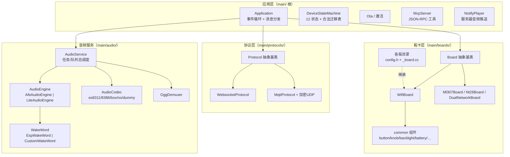

# 01 总体架构

## 1. 分层结构



要点：

- `Application` 是**唯一**的全局协调者；其他模块互相不直接依赖，都通过 Application 的回调/事件位衔接。
- 协议层只知道 `Protocol` 抽象；WebSocket 与 MQTT+UDP 是两个对称实现，由 OTA 下发的配置决定用哪个（`main/application.cc:551-558`）。
- 板卡层通过 `Board::GetInstance()` 单例接入，底层实现由 `DECLARE_BOARD` 生成的 `create_board()` 提供（见 09 章）。

## 2. 目录地图

| 路径 | 职责 |
| --- | --- |
| `main/main.cc` | `app_main()`：NVS 初始化 → Application 初始化 → Run |
| `main/application.cc/.h` | 事件循环、消息分发、状态副作用、激活任务、通知、Schedule |
| `main/device_state*` | 状态枚举与状态机（`IsValidTransition`） |
| `main/ota.cc/.h` | OTA 检查 / 激活接口 / 凭据写入 NVS |
| `main/system_info.cc` | MAC、芯片名、User-Agent |
| `main/mcp_server.cc/.h` | MCP JSON-RPC 服务与内置工具 |
| `main/protocols/` | Protocol / WebsocketProtocol / MqttProtocol / 文本字形载荷 |
| `main/audio/` | AudioService、engines/、wake_words/、codecs/、demuxer/ |
| `main/display/`、`main/led/` | 显示与 LED 实现（可选能力） |
| `main/notify/` | 服务器通知音频的 HTTP 拉流播放器 |
| `main/boards/common/` | Board 基类家族与可复用外设组件 |
| `main/boards/<厂商>/<板>/` | 板级实现：`config.h` + `<board>_board.cc` + `config.json` |
| `main/assets/` | `common/*.ogg`、`locales/<lang>/*.ogg`、字体/表情资源源 |
| `scripts/` | build.py、release.py、gen_lang.py、versions.py、tests/ |
| `docs/` | 上游协议文档：websocket.md、mqtt-udp.md、mcp-protocol.md、blufi.md、notify.md 等 |

## 3. 任务模型

主循环之外的全部常驻/临时 FreeRTOS 任务（`main/audio/audio_service.cc:117-171`、`afe_audio_engine.cc:212-235,546-625`、`main/application.cc:378-393`、`main/notify/notify_player.cc:30-77`）：

| 任务 | 栈 | 优先级 | 绑核 | 职责 |
| --- | --- | --- | --- | --- |
| 主任务（app_main 所在） | — | 提升至 10（application.cc:183） | — | 事件组循环：状态副作用、JSON 分发、发送音频、Schedule 队列 |
| `audio_input`（AFE 目标） | 6144B | 8 | 核 0 | I2S 读取 + 喂引擎；非 AFE 目标栈 4096B、不绑核 |
| `audio_output` | 4096B（AFE）/2048B | 4 | — | 弹播放队列 → codec 输出、上报进度 |
| `opus_codec` | 24576B | 2 | — | 单任务双职责：Opus 解码 → 播放队列；Opus 编码 → 发送队列 |
| `audio_afe`（仅 S3/P4/S31） | 4096B（栈在 PSRAM） | 3 | — | AFE fetch → 唤醒词/VAD/AEC 结果分发 |
| `encode_wake_word`（按需自删） | 24576B | 2 | — | 唤醒词缓存音频编码为 Opus |
| `activation`（一次性） | 8192B | 2 | — | CheckNewVersion → InitializeProtocol |
| `notify_http`（一次性） | 6144B | 2 | — | HTTP 拉流通知音频进解码队列 |

另有 1s 周期 esp_timer：`audio_power_timer`（codec 空闲 15s 断电，audio_service.cc:837-857）与状态栏节拍（application.cc:38-48,107）。

**线程规则**：任何任务都可以读状态、调 `Schedule()`；**只有主任务**执行状态副作用、协议 JSON 处理、MCP 工具回调、`SendText`（Pong 例外也是经 Schedule 切回主任务，websocket_protocol.cc:161-170）。

## 4. 事件驱动模型

主循环 = `xEventGroupWaitBits` 等待 15 个事件位（`main/application.h:25-39`），按固定优先级顺序处理（application.cc:181-296）：

| # | 事件位 | 来源 | 处理 |
| --- | --- | --- | --- |
| 1 | `MAIN_EVENT_ERROR` | 协议 `on_network_error_` | 停通知、回 Idle、Alert+提示音 |
| 2 | `MAIN_EVENT_NETWORK_CONNECTED` | Board 网络回调 | Starting/WifiConfiguring → 创建 activation 任务 |
| 3 | `MAIN_EVENT_NETWORK_DISCONNECTED` | Board/扫描 | 停通知/关音频通道 |
| 4 | `MAIN_EVENT_ACTIVATION_DONE` | ActivationTask | → Idle、成功音、释放 Ota |
| 5 | `MAIN_EVENT_STATE_CHANGED` | 状态机监听器 | 执行目标状态的副作用（见 05 章） |
| 6 | `MAIN_EVENT_PLAYBACK_DRAINED` | 音频回调 | 通知完成判定；自动模式延迟开麦 |
| 7 | `MAIN_EVENT_TOGGLE_CHAT` | 板级按键 | 切换对话状态 |
| 8 | `MAIN_EVENT_START_LISTENING` / `_STOP_LISTENING` | 板级按键 | 开始/停止录音 |
| 9 | `MAIN_EVENT_SEND_AUDIO` | 音频回调 | 循环 Pop → `protocol_->SendAudio`，失败丢全批 |
| 10 | `MAIN_EVENT_WAKE_WORD_DETECTED` | 音频回调 | Idle/Notifying→开通道；Speaking→打断 |
| 11 | `MAIN_EVENT_VAD_CHANGE` | 音频回调 | Listening 态刷新 LED |
| 12 | `MAIN_EVENT_SCHEDULE` | `Schedule()` | 执行回调队列 |
| 13 | `MAIN_EVENT_CLOCK_TICK` | 1s 定时器 | 状态栏刷新、10s 打印堆水位 |
| 14 | `MAIN_EVENT_STARTUP_HINT_TIMEOUT` | 5s 定时器 | 隐藏开机唤醒词提示 |

## 5. Schedule 机制（跨任务投递）

```cpp
void Application::Schedule(std::function<void()>&& callback) {
    { std::lock_guard<std::mutex> lock(mutex_);
      main_tasks_.push_back(std::move(callback)); }
    xEventGroupSetBits(event_group_, MAIN_EVENT_SCHEDULE);
}  // main/application.cc:1248-1254
```

- 结构：`std::mutex` + `std::deque<std::function<void()>>`（application.h:133-134），**不是** FreeRTOS 队列。
- 执行：主循环 SCHEDULE 分支加锁整体搬走后逐个执行（application.cc:270-277）。
- 使用纪律：回调里**不得阻塞、不得递归 Schedule 无限次**；一切"改状态、发消息、动 UI"的跨任务需求都走这里。

## 6. 核心对象与单例

| 对象 | 获取方式 | 说明 |
| --- | --- | --- |
| `Application` | `Application::GetInstance()` | Meyers 单例，持有事件组/状态机/音频服务/协议 |
| `Board` | `Board::GetInstance()` | 静态局部指针 = `create_board()`（board.h:62-65），首次调用时构造 |
| `McpServer` | `McpServer::GetInstance()` | 工具注册表 + JSON-RPC 分发 |
| `AudioService` | `Application` 成员 | 任务与队列的所有者 |
| `WifiManager/SsidManager` | 组件 `78/esp-wifi-connect` | 配网与站点管理（外部组件） |
| `Settings` | `Settings("ns")` | NVS 封装（settings.h），命名空间：`wifi`/`mqtt`/`websocket`/`board`/`audio`/`vendor` |

## 7. 设计不变量（改代码前自查）

1. 状态迁移校验可在任意线程（`TransitionTo` 原子），但**副作用全在主任务**（监听器只置事件位，application.cc:102-104）。
2. `FatalError` 不可迁出；`Notifying` 只能回 `Idle`（device_state_machine.cc:97-102）。
3. 音频队列满的策略：编码队列丢最旧帧并限频告警（audio_service.cc:589-606）；发送侧协议失败丢弃整批剩余包避免死锁（application.cc:245-257 注释）。
4. 提示音与对话共用同一条解码/播放链；`ResetDecoder()` 会立刻作废在播提示音（audio_service.cc:802-822）——改动抢占顺序前先看 08 章。
5. NVS 键是持久 API：改键名必须写迁移（`wifi.ota_url`、`mqtt.*`、`websocket.*`、`board.uuid`、`audio.volume` 等）。
