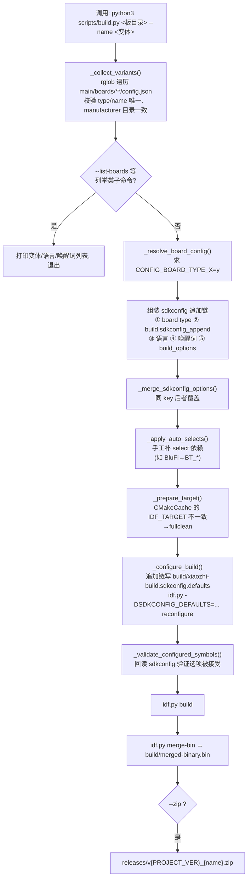
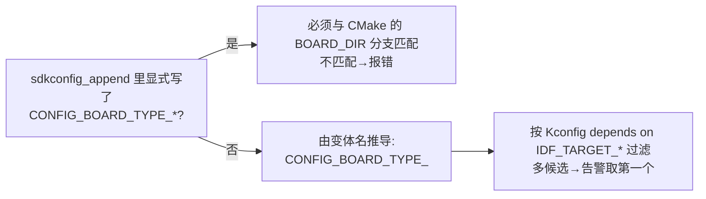

# 02 构建体系与变体

> 字段级参考见 [../baseline-review/01-build-system.md](../baseline-review/01-build-system.md)；本章聚焦"一次构建是怎么发生的"。

## 1. 全链路总图



## 2. 配置的三个源头与一层合成

**板卡目录 `config.json`**（唯一配置入口，无顶层聚合文件）声明：`type`（上报型号）、`target`（芯片）、`manufacturer`、`builds[]`（变体，含 `sdkconfig_append` / `build_options` / `idf_version` 门控 / `legacy_names`）。

**build.py 合成 sdkconfig 追加链**，顺序即优先级（后者覆盖前者）：

1. `CONFIG_BOARD_TYPE_X=y`（由 `_resolve_board_config` 决定）
2. build 的 `sdkconfig_append`（若显式写 board type，必须与解析结果一致，`build.py:1583-1591` 会替换为规范符号）
3. 语言：`CONFIG_LANGUAGE_XXX=y`（`--language`，默认 en-US）
4. 唤醒词：`--wake-word` → `CONFIG_USE_ESP_WAKE_WORD/USE_AFE_WAKE_WORD/...=y` + 模型名
5. 语义 `build_options`（`--build-options-json`）展开成 CONFIG 项
6. `_apply_auto_selects()` 声明式补依赖（BluFi→BT 三件套；SPIRAM=n→LVGL malloc 池）

**写入方式**：不修改 `sdkconfig.defaults`，而是生成 `build/xiaozhi-build.sdkconfig.defaults` 片段，与默认值一起传给 `-DSDKCONFIG_DEFAULTS`；旧 `sdkconfig` 备份为 `sdkconfig.old`（`build.py:1420-1454`）。

## 3. `CONFIG_BOARD_TYPE_X` 的解析优先级（`build.py:1208-1271`）



## 4. Kconfig ↔ CMake ↔ 板目录的一致性链

```
Kconfig choice BOARD_TYPE 条目(171 个, 每个 depends on IDF_TARGET_*)
        ↕ 名字必须对应
CMakeLists.txt:94-900  if(CONFIG_BOARD_TYPE_X) → set(BOARD_DIR "<目录>")   无匹配→FATAL_ERROR
        ↕ BOARD_DIR 决定
main/boards/<目录>/config.json + config.h + <board>_board.cc
```

三处名字必须同时存在且指向同一目录——这是"加一块板要改四层"的根本原因（清单见 03 章 §5）。build.py 用文本正则模拟这条链做预校验；正则与真实 Kconfig/CMake 求值的偏差是已知风险点（见待验证项）。

## 5. 产物与命名

| 产物 | 规则 | 位置 |
| --- | --- | --- |
| 合并固件 | `build/merged-binary.bin` | `idf.py merge-bin` |
| 发布 zip | `releases/v{PROJECT_VER}_{manufacturer-}{name}.zip`，内含 `merged-binary.bin` | `build.py:86-97,148-155` |
| 版本号 | 根 `CMakeLists.txt:12` 的 `PROJECT_VER`（当前 `2.5.3`） | `build.py:50-56` |
| GitHub Release | `release.py prepare/publish`（manifest + SHA256SUMS + 防覆盖） | `scripts/release.py` |

## 6. 常用命令

```sh
source /path/to/esp-idf/export.sh      # 先激活 IDF（要求 ≥6.0.1，推荐 6.1）
python3 scripts/build.py --list-boards                       # 列全部 191 个变体
python3 scripts/build.py m5stack/tab5 --name m5stack-tab5    # 构建单变体
python3 scripts/build.py <板> --name <变体> --language zh_CN --wake-word hiesp --zip
python3 -m unittest discover -s scripts/tests -v             # 宿主测试（10 个文件）
```

CI 侧另有 `--select-changed`（按变更文件挑变体）与 `scripts/ci/representative-variants.json`（18 个代表变体），详见 [../baseline-review/04-ci-workflows.md](../baseline-review/04-ci-workflows.md)。

## 7. 待验证与已知风险

1. build.py 对 Kconfig/CMake 的正则解析未与真实 `idf.py reconfigure` 全量对拍；`_AUTO_SELECT_RULES` 是手工模拟 select。
2. `dependencies.lock` 不在仓库中，组件版本未锁定（影响可复现构建）。
3. `legacy_names` 仓库内无消费方，疑为服务端元数据。
4. 191 个变体未做本地全量构建（CI 矩阵覆盖代表变体 + 受影响板卡）。
