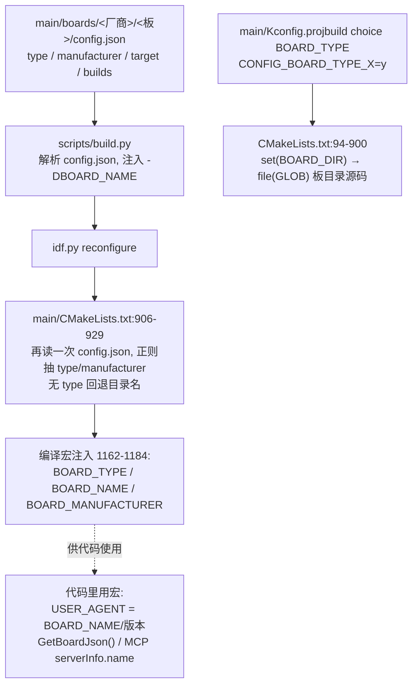
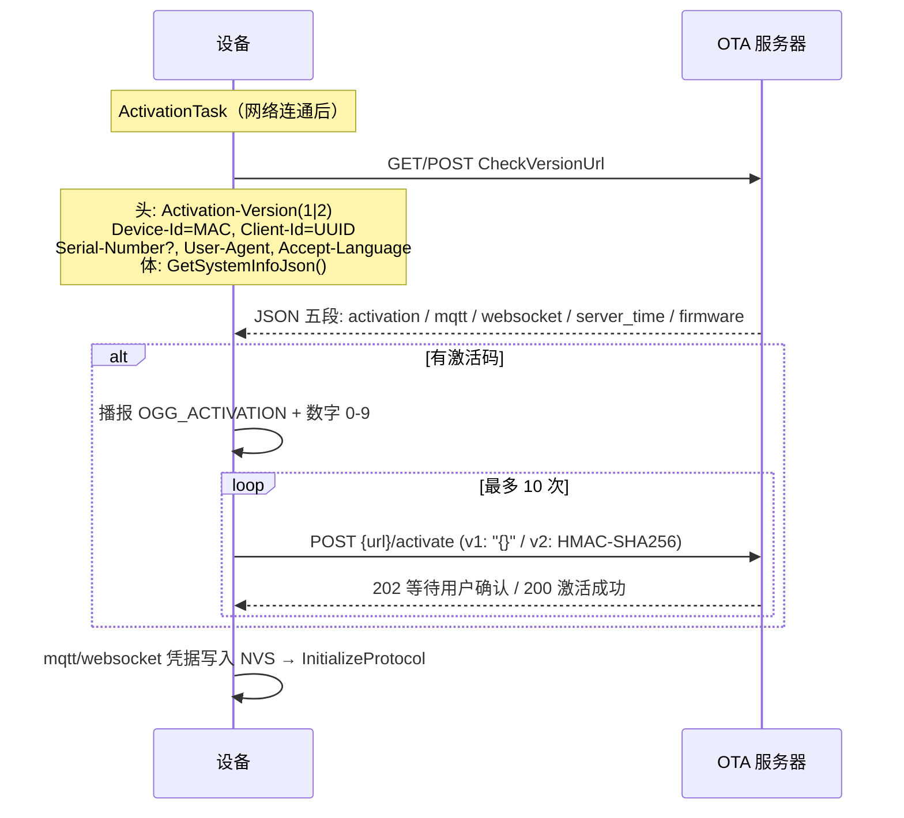

# 03 型号判定与设备身份

> 回答三个问题：编译出来的固件"是谁"（编译期）、运行时"我是谁"（设备身份）、以及"服务器怎么认我"（上报与认证）。

## 1. 编译期型号链路

- **编译宏**（构建期写死）：`BOARD_TYPE`（上报用型号）、`BOARD_NAME`（变体名，可被 `-DBOARD_NAME` 覆盖，缺省回退 BOARD_TYPE）、`BOARD_MANUFACTURER`。
- **Kconfig 条目**只负责 menuconfig 选板（互斥 choice + `depends on IDF_TARGET_*`），不携带上报名。
- 一个板目录可以对应多个 Kconfig 条目/多个变体（同族硬件版本），例如 `waveshare/esp32-p4-wifi6-touch-lcd` 一个目录 8 个 Kconfig 条目（`main/CMakeLists.txt:534-583`）。

## 2. 运行时设备身份

| 身份 | 来源 | 持久化 | 用途 | 位置 |
| --- | --- | --- | --- | --- |
| MAC 地址 | `SystemInfo::GetMacAddress()`（冒号小写） | 芯片 eFuse | HTTP 头 `Device-Id` | system_info.cc:35-47 |
| UUID | `Board` 构造时生成 UUIDv4 | NVS `board.uuid` | HTTP 头 `Client-Id`、系统信息 | board.cc:14-43 |
| 序列号（可选） | eFuse `ESP_EFUSE_USER_DATA` | 产测烧写 | 激活 v2（HMAC 应答） | ota.cc:29-51 |
| 应用版本 | `esp_app_get_description()->version` | 固件内 | User-Agent、OTA 比较 | system_info.cc:53-57 |
| 芯片信息 | `CONFIG_IDF_TARGET` + efuse | — | 系统信息 JSON | system_info.cc:49-51 |

**结论**：设备身份 = MAC + UUID + （可选）eFuse 序列号；没有任何"产品 SKU"字段——产品层如果要 SKU 标识，需要新增（可参照 `BOARD_*` 宏的注入方式）。

## 3. 服务器怎么认设备（OTA 上报时序）

- OTA URL：NVS `wifi.ota_url` 优先，否则 `CONFIG_OTA_URL`（默认 `https://api.tenclass.net/xiaozhi/ota/`，`ota.cc:56-63`、`main/Kconfig.projbuild:3-7`）。
- 激活 v2 凭据：eFuse HMAC_KEY0 对服务器 challenge 做 HMAC-SHA256（`ota.cc:467-502`）；v1 设备无密码学凭据。
- 凭据（MQTT 用户名密码 / WS token）**全部由服务器下发**写入 NVS，设备不本地计算（`ota.cc:160-199`）。

## 4. 型号判定的一致性风险点

| 风险 | 案例 | 后果 |
| --- | --- | --- |
| 目录存在但无 config.json | `main/boards/kevin/sp-v3-dev`（Kconfig/CMake 有条目） | 构建矩阵覆盖不到，release 无法产出 |
| config.json target 与 Kconfig 依赖不符 | `espressif/esp-spot`：config 只声明 c5，Kconfig 另有 `BOARD_TYPE_ESP_SPOT_S3` | S3 变体如何选定 target 需构建验证 |
| Kconfig/CMake 名字拼写不一致 | — | build.py 预校验能拦一部分；最终以 reconfigure 报错为准 |

上游同步合并冲突最常发生在：`main/Kconfig.projbuild`（choice 列表）、`main/CMakeLists.txt`（if/elseif 链）、各板 config.json。**产品定制不要直接改这三处既有内容，用新增条目**。

## 5. 新增一块板需要动的文件（现状清单）

1. `main/boards/<厂商>/<板名>/config.h` — 引脚与外设宏。
2. `main/boards/<厂商>/<板名>/<板名>_board.cc` — 板类（继承 `WifiBoard` 等）+ 末尾 `DECLARE_BOARD(XxxBoard);`。
3. `main/boards/<厂商>/<板名>/config.json` — `type`/`manufacturer`/`target`/`builds`。
4. `main/Kconfig.projbuild` — `choice BOARD_TYPE` 内新增条目 + `depends on IDF_TARGET_*`。
5. `main/CMakeLists.txt` — if/elseif 链新增 `CONFIG_BOARD_TYPE_* → BOARD_DIR`，设置字体/表情默认值；需要额外组件时追加依赖（1100-1125）。
6. 板级专属显示驱动不在公共层时，在对应分支 `list(APPEND SOURCES ...)`（参照 maza-ai，`main/CMakeLists.txt:218-231`）。

板类文件怎么写（codec/display/button 初始化顺序、工具注册）见 09 章 §5。
