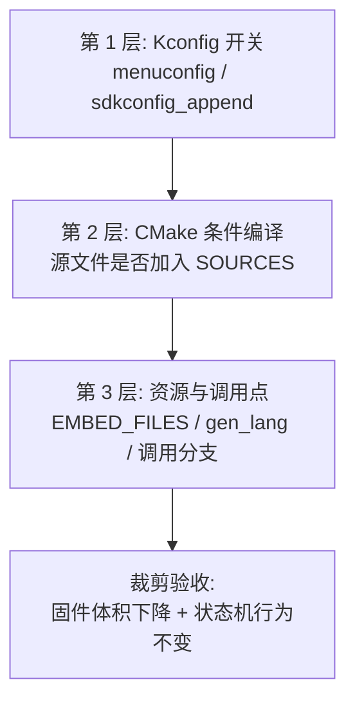
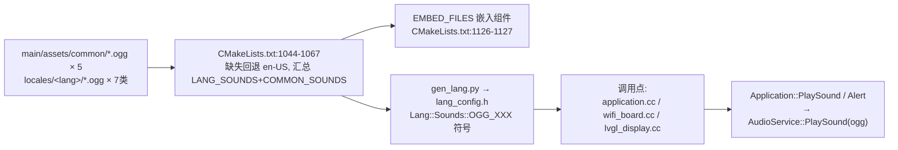

# 04 功能裁剪指南

> 原则：**编译期裁剪优先**——关掉功能时不只隐藏 UI，还要不编译代码、不打包资源。本章给出每个功能的"裁剪面"清单。

## 1. 三层裁剪模型

**大多数功能第 1、2 层已具备；唯独"提示音"第 3 层没有开关**（声音无条件 EMBED），是裁剪工作量最大的项。

## 2. 裁剪矩阵总表

| 功能 | Kconfig 开关 | 源文件条件 | 资源影响 | 备注 |
| --- | --- | --- | --- | --- |
| 配网-热点 | `USE_HOTSPOT_WIFI_PROVISIONING`（默认 y） | wifi_board.cc 内分支 | 无 | 关掉热点只剩 BluFi 路径 |
| 配网-BluFi | `USE_ESP_BLUFI_WIFI_PROVISIONING` | `blufi.cpp` 仅此开关编译（CMakeLists:953-955） | 无 | 开启时 auto-select BT_ENABLED 等（build.py:1277-1285 手工补）；要求客户端支持 PSA Crypto/ffdhe3072 |
| 唤醒词 | choice `WAKE_WORD_TYPE`：`DISABLED`/`USE_ESP_WAKE_WORD`/`USE_AFE_WAKE_WORD`/`USE_CUSTOM_WAKE_WORD` | 引擎按芯片二选一（CMakeLists:943-950） | esp-sr 模型（managed_components） | AFE 仅 S3/P4/S31+PSRAM；lite 无 AEC/VAD |
| 唤醒词数据上传 | `SEND_WAKE_WORD_DATA` | — | — | 仅 AFE/Custom 路径有效（Lite 引擎为空实现，esp_wake_word.cc:133-138） |
| 设备端 AEC | `USE_DEVICE_AEC`（depends 一串板） | AFE 配置分支 | — | 需 codec 提供参考声道 |
| 服务器 AEC | `USE_SERVER_AEC` | 时间戳链路（audio_service.cc:359-367,579-583） | — | hello `features.aec:true` |
| 摄像头 | 无全局开关（能力可选） | S3→esp32_camera；S3/P4/S31→esp_video（1084-1098）；esp32 全剔除 | esp32-camera/esp_video 组件 | `Board::GetCamera()` 返回 null 即无 |
| 资源(字体/表情) | choice `FLASH_NONE/DEFAULT/CUSTOM/EXPRESSION_ASSETS` | build_default_assets 分支 | assets.bin 打包与否 | **现成的资源级裁剪** |
| 显示 | 板级子 choice（OLED/LCD/STYLE 等） | `NoDisplay` 兜底 | 字体/表情 | 显示是可选能力 |
| 音频调试 | `USE_AUDIO_DEBUGGER` | audio_debugger.cc | 无 | UDP 原始 PCM 外发，量产必关 |
| 自定义消息 | `RECEIVE_CUSTOM_MESSAGE` | application.cc:716-732 | 无 | 关闭后 `type=custom` 仅告警 |
| 文本字形推送 | 随字体能力自动 | text_glyph | — | hello 里 `features.glyph_push` |

## 3. 专项：提示音（工作量最大的裁剪项）

现状：声音经 `EMBED_FILES` **无条件**嵌入，无任何策略开关。完整链路：

**要裁掉一类提示音需要同时动三处**：

1. 调用点：加条件分支（调用点清单：激活播报 application.cc:754,760；成功 373；配网 wifi_board.cc:186；通知前 1207；服务器 alert 706-712；低电量 lvgl_display.cc:274；SIM 错误 156-167）。
2. 打包：`main/CMakeLists.txt:1126-1127` 的 `EMBED_FILES ${LANG_SOUNDS} ${COMMON_SOUNDS}` 按开关过滤。
3. 生成器：`scripts/gen_lang.py` 与 `language.json` 的 sounds 段（符号缺失会导致编译错误，需同步）。

**红线**：关掉"激活语音"只应替换反馈通道（屏幕/LED/日志），激活业务逻辑（轮询 `/activate`）必须保留——反馈与业务在代码里是分开的（`ShowActivationCode` 只做反馈，轮询在 `CheckNewVersion`）。

## 4. 裁剪操作规程（建议）

## 5. 裁剪验收清单

- [ ] 关闭项的 CONFIG 在最终 sdkconfig 中为 n（回读验证，build.py 已内置 `_validate_configured_symbols`）。
- [ ] 相关 `.cc` 未进 `build/` 编译清单（查 `build/project_description.json` 或构建日志）。
- [ ] 相关资源未进固件（`esptool image_info` 或 zip 体积对比）。
- [ ] 被裁功能的**业务流程**仍走通（如关激活语音后激活仍成功）。
- [ ] 关联的 auto-select 依赖同步消失（如关 BluFi 后 BT 组件不编入）。
- [ ] OTA 兼容性：同型号新旧固件的分区/资产布局兼容。
