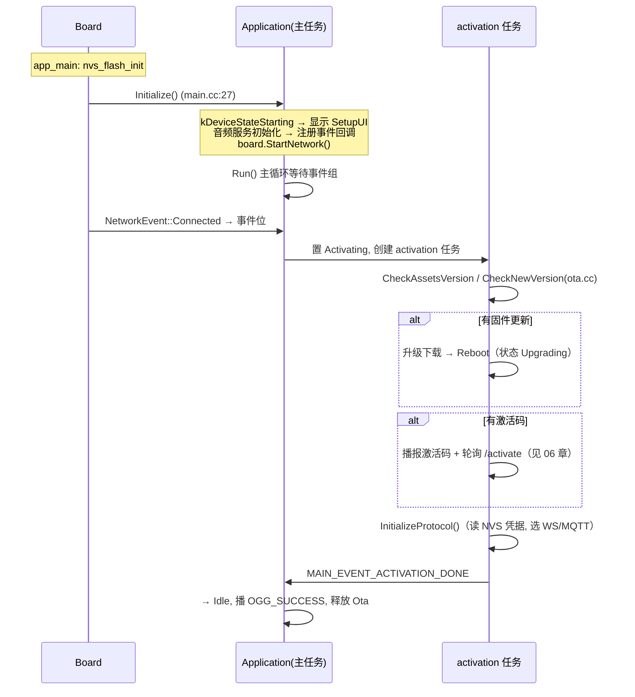
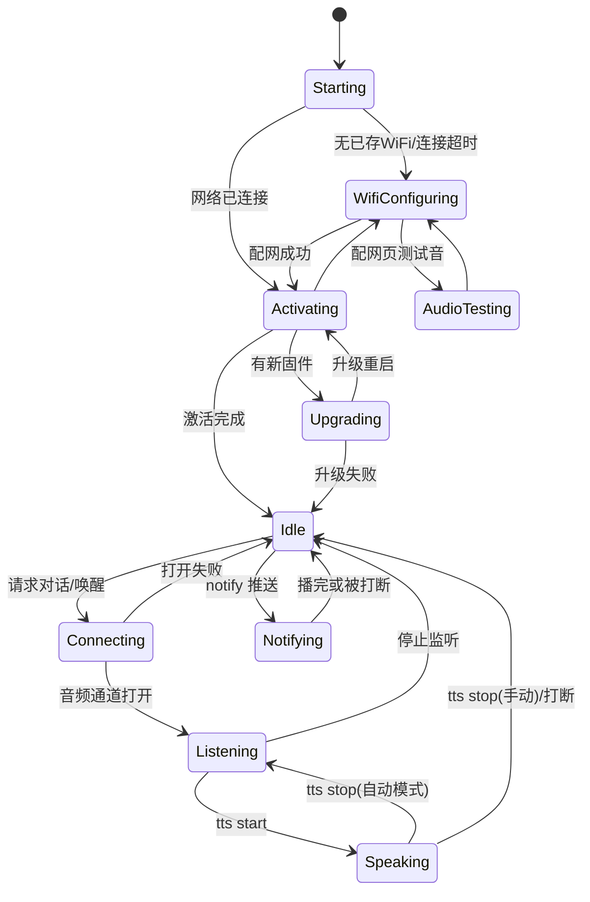

# 05 启动流程与设备状态机

## 1. 上电启动时序

## 2. 设备状态机

12 个状态（`main/device_state.h:4-17`），合法迁移表 `main/device_state_machine.cc:35-107`：

- 非法迁移：告警并拒绝（`TransitionTo` 返回 false，不抛错）。
- `FatalError` 不可迁出；`Notifying` 只能回 `Idle`；`Upgrading` 只能去 `Idle`/`Activating`。
- 唯一入口 `Application::SetDeviceState()` → `state_machine_.TransitionTo()`（application.cc:64）；监听器只置 `MAIN_EVENT_STATE_CHANGED`，**副作用统一在主循环执行**。

## 3. 各状态副作用（`HandleStateChangedEvent`，application.cc:1020-1082）

| 状态 | 音频处理 | 唤醒词检测 | 其他 |
| --- | --- | --- | --- |
| Idle | 关 | 开 | 显示 STANDBY/neutral |
| Connecting | 关 | 保持 | 状态栏 CONNECTING |
| Listening | 开（自动模式等播放排空再开麦） | 按 Kconfig | `SendStartListening` |
| Speaking | 关（Realtime 除外） | AFE 保留 | `ResetDecoder()` |
| Notifying | 关 | AFE 保留 | notify_player 播放中 |
| WifiConfiguring | 关 | 关 | 配网页面 |

## 4. 主循环与事件位

15 个事件位定义于 `main/application.h:25-39`，处理顺序与动作见 01 章 §4。这里补充两条最容易踩的语义：

- **SEND_AUDIO 失败即弃**：发送失败丢弃发送队列全部剩余包，防止编码任务被满队列卡死（application.cc:245-257 注释）。
- **自动对话模式**：Idle 不自动进 Listening；"自动"指会话内 TTS stop 后自动续听（application.cc:642-651），且开麦会等播放队列排空（`pending_listening_start_` + PLAYBACK_DRAINED，application.cc:220-231,1045-1054）。默认模式：无 AEC → `auto_stop`，有 AEC → `realtime`（application.cc:1269-1271）。

## 5. Schedule 与线程纪律

- 回调可能来自：协议收包任务（组件回调）、音频任务、定时器、板级按键任务 → **一律 Schedule** 到主任务再改状态/动 UI。
- `Schedule` 实现：mutex + deque + 事件位（application.cc:1248-1254）。
- 反例警示：WS Pong 若在组件 AT 任务直接发送会出问题，上游特意 Schedule 回主任务发（websocket_protocol.cc:161-170）——新代码涉及"在网络/音频任务里发协议消息"时照此办理。

## 6. 排错速查

| 症状 | 先看 |
| --- | --- |
| 卡在 Starting | `StartNetwork()` / Wi-Fi 凭据 / `TryWifiConnect` 60s 超时（wifi_board.cc:100-168） |
| 卡在 Activating | OTA URL 可达性、`/activate` 响应、激活码轮询 10 次上限（application.cc:527-540） |
| Illegal transition 告警 | 违反 §2 迁移表；找所有 `SetDeviceState` 调用点核对线程与状态 |
| 唤醒无反应 | 08 章唤醒词动作链 + 事件位 `WAKE_WORD_DETECTED` 是否置位 |
| 提示音被"吞" | `ResetDecoder()` 抢占语义（audio_service.cc:802-822），见 08 章 |
