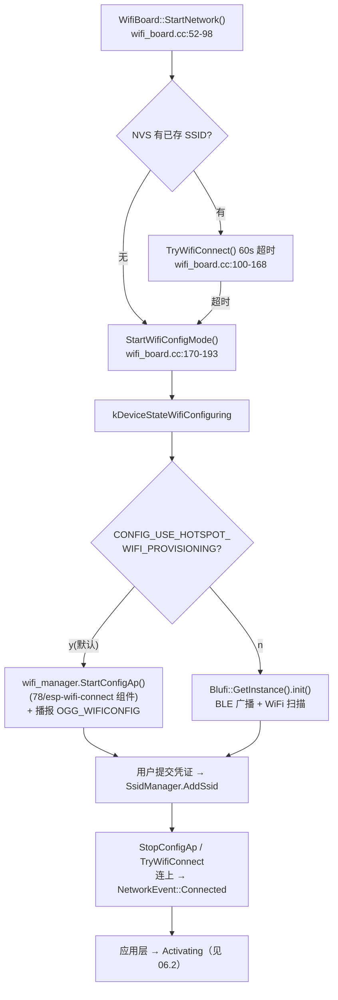

# 06 配网与激活流程

## 1. 配网：触发点与两条通道



要点：

- 配网入口编译期二选一靠 Kconfig menu "WiFi Configuration Method"（`main/Kconfig.projbuild:1054-1070`）；默认热点。
- **AP 配网页面的 HTTP 接口在外部组件 `78/esp-wifi-connect: ~3.3.1`**（`main/idf_component.yml:27`），本仓库只见 SSID 前缀 "Xiaozhi"（wifi_board.cc:57）与进出回调（wifi_board.cc:87-92,138-147）。
- BluFi 实现 `main/boards/common/blufi.cpp`：`init()` 起 BLE；收到 `REQ_CONNECT_TO_AP` 存凭证（blufi.cpp:866-900）；连上网后 `deinit()`（wifi_board.cc:122-125）。开启时 build.py 自动补 BT 依赖。
- 运行期可主动重进配网：`EnterWifiConfigMode()`（wifi_board.cc:195-235），板级按键调用；会先 `Application::ResetProtocol()` 释放协议连接。
- 自定义热点名/页面 → 属于 esp-wifi-connect 组件侧定制，不在本仓库。

## 2. 激活与首次上线

```mermaid
sequenceDiagram
    participant App as Application
    participant O as Ota(ota.cc)
    participant S as OTA 服务器
    App->>O: CheckVersion()
    Note over O: 头: Activation-Version / Device-Id(MAC)<br/>Client-Id(UUID) / Serial-Number? / User-Agent
    O->>S: GET/POST CheckVersionUrl
    S-->>O: activation / mqtt / websocket / server_time / firmware
    O->>App: 解析五段; mqtt/websocket 写入 NVS; server_time 校时
    alt firmware 有新版本
        App->>App: 下载固件 → Upgrading → 重启
    end
    alt activation.code 存在（未激活设备）
        App->>App: ShowActivationCode: OGG_ACTIVATION + 逐位播数字<br/>(application.cc:741-763)
        loop 最多 10 次（含 timeout_ms 间隔）
            App->>O: Activate()
            O->>S: POST {url}/activate
            Note over O: v1(无序列号): body="{}"<br/>v2(有 eFuse 序列号): HMAC-SHA256(challenge)
            S-->>O: 202=等待用户在服务器输入激活码<br/>200=激活成功
        end
    end
    App->>App: InitializeProtocol(): 凭据生效 → MAIN_EVENT_ACTIVATION_DONE → Idle
```

- 激活码与绑定关系完全在**服务器侧**；设备只负责播报与轮询。
- v2 的 HMAC 密钥是 eFuse HMAC_KEY0（产测烧写，固件只读，`ota.cc:467-502`）。
- OTA URL：NVS `wifi.ota_url` > `CONFIG_OTA_URL`；**接自有服务端的最小改动 = 改 Kconfig 默认值**（协议不变时）。

## 3. 凭据与身份的现状（对照"自有注册体系"设计）

| 数据 | 现状 | 存储 |
| --- | --- | --- |
| 设备标识 | MAC + UUIDv4 | eFuse / NVS `board.uuid` |
| 设备凭据 | v1 无；v2 eFuse HMAC 挑战应答 | eFuse |
| 通信凭据 | 服务器经 OTA 响应**下发**：`mqtt.{endpoint,client_id,username,password,keepalive,publish_topic}`、`websocket.{url,token,version}` | NVS `mqtt` / `websocket` 命名空间（ota.cc:160-199） |
| 用户绑定 | 激活码机制，服务器侧完成 | 服务器 |
| 功能授权 | **不存在** | — |

**给产品化的提示**：设备侧没有共享密钥、没有本地授权判断；新增"自有注册/授权"时应保持"设备只持有标识 + 服务器下发短期凭据"的形态，避免把长期密钥写进固件或二维码。

## 4. 待验证

1. esp-wifi-connect 组件内 AP 页面的具体路由/字段（需拉取组件源码核对）。
2. BluFi PSA Crypto 与配套 App 的联调（Kconfig help 要求 ffdhe3072/SHA-256/AES-CTR）。
3. `welcome.ogg` 未发现调用点，疑为遗留资源（裁剪时可确认后删除）。
4. 服务器响应字段以 `api.tenclass.net` 实测为准；固件端解析约定见 `ota.cc:85` 注释（指向上游维护的协议说明）及 `docs/websocket.md`、`docs/mqtt-udp.md`。
