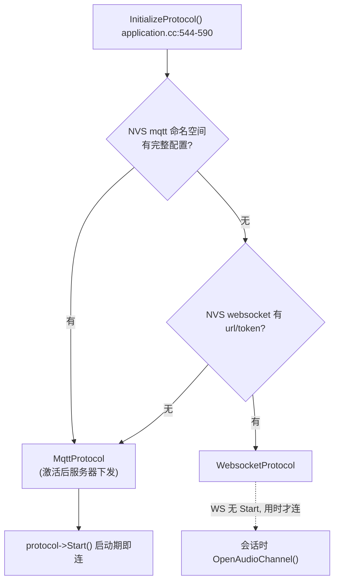
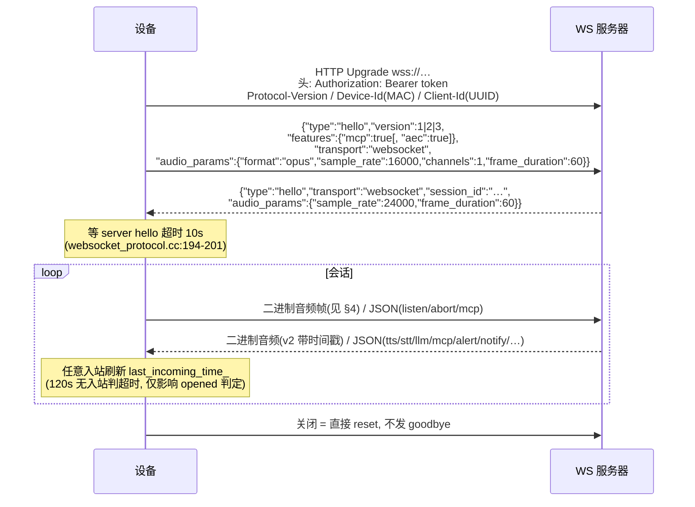

# 07 通讯流程（WebSocket / MQTT+UDP）

> 官方协议文档：`docs/websocket.md`、`docs/mqtt-udp.md`（含中文版 `_zh`）；本章是代码实现视角的补充与索引。
> **线缆级总规格（含 OTA/激活、MCP、Notify 通道与字段字典）见 [11-server-protocol-spec.md](11-server-protocol-spec.md)**。

## 1. 通道选择与生命周期



- 回调接线（application.cc:560-590）：`OnIncomingJson` → 主任务分发；`OnIncomingAudio` → 解码队列；`OnAudioChannelOpened/Closed` → 状态联动；`OnNetworkError` → `MAIN_EVENT_ERROR`。
- 共享语义全在 `Protocol` 基类：session_id、120s 超时、五种文本消息拼装（protocol.cc:66-117）。

## 2. WebSocket 会话时序



## 3. MQTT + 加密 UDP 会话时序

```mermaid
sequenceDiagram
    participant D as 设备
    participant M as MQTT Broker
    participant U as UDP 音频服务
    Note over D: 启动期 StartMqttClient():<br/>endpoint[:8883] client_id/username/password<br/>全部来自 NVS mqtt 命名空间
    D->>M: MQTT Connect(TLS), keepalive 默认 240s
    D->>M: publish hello(version=3, transport="udp")
    M-->>D: hello: session_id + audio_params +<br/>udp{server, port, key(16B hex), nonce(16B hex)}
    Note over D: PSA 导入 AES-128-CTR key<br/>local/remote_sequence 复位
    D->>U: UDP Connect(server, port)
    loop 音频双向
        D->>U: 16B 头+AES-CTR 密文 opus
        U-->>D: 同构帧; sequence 防重放
    end
    D->>M: JSON 消息走 publish_topic
    M-->>D: JSON 消息(hello/goodbye 通道层拦截)
    Note over D,M: 控制连接断开: 60s 后仅 Idle 态重连<br/>(mqtt_protocol.cc:20-38,100-107)
    D->>M: 客户端主动关闭才发 goodbye
```

## 4. 音频帧格式

### 4.1 WebSocket 二进制帧（`websocket_protocol.cc:24-54,108-140`）

| version | 头 | 布局 |
| --- | --- | --- |
| 1（默认） | 无 | 裸 Opus 负载 |
| 2 | 16B 大端 | `version u16 / type u16(0=opus) / reserved u32 / timestamp u32(ms, 服务器 AEC 用) / payload_size u32` |
| 3 | 4B | `type u8 / reserved u8 / payload_size u16(大端)`，无时间戳 |

注意：接收侧未实现 `type==1`（JSON 帧）分支（websocket_protocol.cc:124-132）。

### 4.2 UDP 帧（收发同构，`mqtt_protocol.cc:24-47,210-246,303-364`）

```
| type 1B(0x01) | flags 1B | payload_len 2B | ssrc 4B | timestamp 4B | sequence 4B | AES-CTR 密文(payload_len) |
```

- AES-128-CTR：key 来自 hello `udp.key`；**IV = 16B nonce 模板**，改写偏移 2-3=payload_len、8-11=timestamp、12-15=sequence（发送侧每帧 `++local_sequence_`，mqtt_protocol.cc:210-232）。
- 防重放：`sequence <= remote_sequence_` 丢弃；解密成功才推进（cc:332-364）。
- 上行 timestamp = 最近一次播出的下行帧时间戳（`timestamp_queue_`，audio_service.cc:359-367,579-583），供服务器回声消除对齐。

## 5. JSON 消息全集

### 5.1 设备 → 服务器（protocol.cc:66-106）

| 消息 | 结构 |
| --- | --- |
| hello | 见 §2/§3 时序图（WS version 1/2/3；MQTT 固定 3） |
| listen start | `{"session_id","type":"listen","state":"start","mode":"auto"\|"manual"\|"realtime"}` |
| listen detect | `{"session_id","type":"listen","state":"detect","text":"<唤醒词>"}` |
| listen stop | `{"session_id","type":"listen","state":"stop"}` |
| abort | `{"session_id","type":"abort"[,"reason":"wake_word_detected"]}` |
| mcp | `{"session_id","type":"mcp","payload":<JSON-RPC 原样>}` |
| goodbye | 仅 MQTT 客户端主动关闭时发（mqtt_protocol.cc:261-266） |

### 5.2 服务器 → 设备（application.cc:592-736 分发；hello/goodbye 被通道层拦截）

| type | 关键字段 | 设备动作 |
| --- | --- | --- |
| tts | state: start/stop/sentence_start(+text, glyph_push) | → Speaking；stop → Idle/自动续听；字幕气泡 |
| stt | text | 显示用户消息 |
| llm | emotion | 表情 |
| mcp | payload | `McpServer::ParseMessage`（见 09 章） |
| notify | audio_url(必填), subtitles[]{start_ms,text} | Idle→Notifying，HTTP 拉流播放 |
| alert | status/message/emotion(全必填) | Alert + OGG_VIBRATION |
| system | command: "reboot" | 重启 |
| custom | payload | 需 `CONFIG_RECEIVE_CUSTOM_MESSAGE` |
| goodbye | session_id | MQTT: 匹配则关通道，不回包（防 ping-pong） |

## 6. 超时 / 重连规则表

| 场景 | 规则 | 位置 |
| --- | --- | --- |
| 等 server hello | 10s 超时 → `SERVER_TIMEOUT` | websocket_protocol.cc:194-201; mqtt_protocol.cc:292-298 |
| 会话空闲 | 120s 无入站 → `IsTimeout()`，仅影响 `IsAudioChannelOpened()` 判定，不主动断 | protocol.cc:108-117 |
| MQTT 控制连接断 | 60s 一次性定时器重连，**仅 Idle 态执行** | mqtt_protocol.cc:20-38,100-107 |
| WebSocket 断 | **无自动重连**；下次按键/唤醒重走 OpenAudioChannel，失败回 Idle | websocket_protocol.cc:172-177; application.cc:835-855 |
| 物理网络断 | `MAIN_EVENT_NETWORK_DISCONNECTED` → 连接/监听/说话态关通道 | application.cc:325-340 |
| WS Ping | Pong 经 Schedule 在主任务回（4G AT 任务不能直接发） | websocket_protocol.cc:161-170 |

## 7. 改协议的注意事项

1. hello/音频帧/JSON 任何变更必须**同时**改 WS 与 MQTT+UDP 两个实现，共享逻辑尽量上移 `Protocol` 基类。
2. `session_id` 是会话关联键：MQTT goodbye 靠它匹配；新消息带会话语义时要带上。
3. 服务器下发的 `audio_params`（采样率/帧长）驱动解码侧重协商（`SetDecodeSampleRate`，audio_service.cc:532-567）——不要写死 24000/60。
4. 新增消息类型：通道层拦截表（hello/goodbye）+ application 分发表 + 协议文档三处同步。
