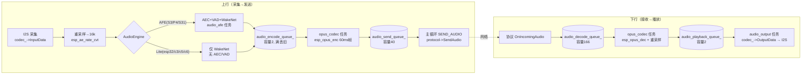
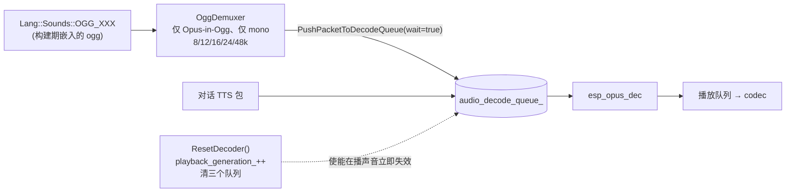
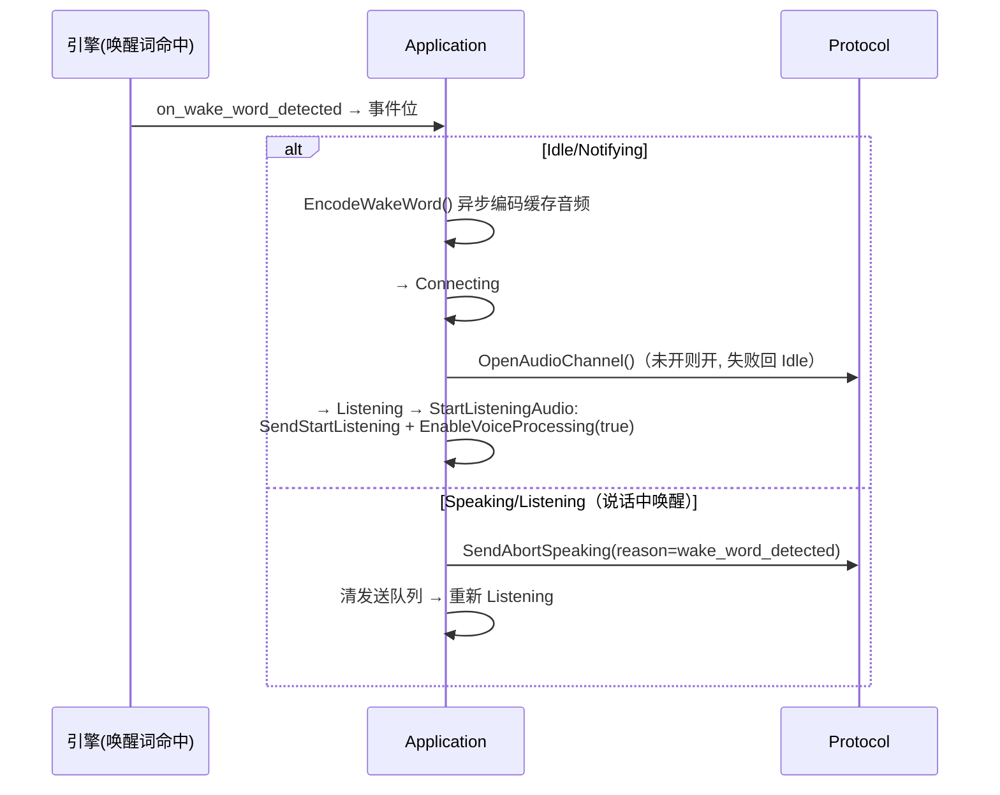

# 08 音频链路

## 1. 数据流总图

- 帧规格：上行强制 16kHz/单声道/60ms Opus；下行采样率与帧长由服务器 hello 协商（默认 24000/60，`protocol.h:79-80`）。
- 编码参数：码率 AUTO、复杂度 0、DTX、VBR（`audio_service.h:67-80`）；帧长常量 `OPUS_FRAME_DURATION_MS=60`（audio_service.h:40）。
- 队列全部为自研定容 `FixedQueue`（mutex+条件变量，`fixed_queue.h`），**不用 FreeRTOS Queue**。

## 2. 任务与队列清单

| 实体 | 容量/栈 | 优先级 | 说明 |
| --- | --- | --- | --- |
| audio_input | 栈 6144B(AFE)/4096B | 8 | 10ms=160 样本轮询读取；AFE 目标绑核 0 |
| audio_output | 栈 4096/2048B | 4 | 播放后上报进度；server AEC 时压时间戳 |
| opus_codec | 栈 24576B | 2 | 单任务双职责（编码+解码），`decoder_mutex_` 保护 |
| audio_afe | 栈 4096B @PSRAM | 3 | fetch → 唤醒词/语音结果分发 |
| encode_wake_word | 栈 24576B | 2 | 按需创建用后自删 |
| audio_encode_queue_ | 2 | — | 满：丢最旧 + 限频告警（audio_service.cc:589-606） |
| audio_send_queue_ | 40 | — | 主循环取尽；发送失败整批丢弃 |
| audio_decode_queue_ | 166（≈10s） | — | 对话入队不等待；PlaySound 用 wait=true |
| audio_playback_queue_ | 2 | — | 排空触发 `on_playback_drained` |
| timestamp_queue_ | 3 | — | 仅 server AEC |

## 3. AFE vs Lite 引擎对比

| 能力 | AfeAudioEngine（S3/P4/S31） | LiteAudioEngine（esp32/c3/c5/c6） |
| --- | --- | --- |
| AEC | 有（需 codec 参考声道；FD low-cost + NLP veryagg） | 无 |
| VAD | 有（VAD_MODE_0） | 无 |
| 唤醒词 | AFE 内 WakeNet 或 MultiNet 自定义 | 独立 WakeNet |
| 唤醒词音频上传 | 支持（缓存 2s PCM → 编码） | 不支持（空实现） |
| 独立任务 | audio_afe + encode_wake_word | 无 |

配置：`AFE_TYPE_FD / AFE_MODE_LOW_COST`、内存偏 PSRAM（afe_audio_engine.cc:126-139,185）。

## 4. 提示音与对话共用一条播放链

- **抢占语义**：进入 Listening/Notifying 或开语音处理前都会 `ResetDecoder()`——提示音会被对话立刻打断，改抢占顺序前先读 audio_service.cc:802-822。
- 通知（notify）音频也走同一条解码链，由 `notify_http` 任务 HTTP 拉流喂入，字幕按 `media_position_ms` 推进（notify_player.cc:174-289）。

## 5. 唤醒词检测后的动作链

## 6. 时间戳与调试

- 上行时间戳（server AEC）：播放任务把播出帧的 timestamp 压入 3 深度队列 → 编码时取队首（audio_service.cc:359-367,579-583）；UDP 帧 IV 内嵌该值。
- `USE_AUDIO_DEBUGGER`：原始 PCM 经 UDP 发到 `CONFIG_AUDIO_DEBUG_UDP_SERVER`（默认 192.168.2.100:8000），量产关闭。
- codec 空闲 15s 自动断电（1s 周期定时器，audio_service.cc:837-857）。

## 7. 待验证

1. 队列元素（`std::vector` payload）的堆落在内部 RAM 还是 PSRAM 未显式指定，取决于 heap 策略——大内存压力场景需实测。
2. `WakeWordAudioCache` 的 64KB PSRAM 环形缓冲按 README 描述，分配代码未逐行核对。
3. MQTT 发送侧完整组包流程仅核对了 timestamp 相关段（mqtt_protocol.cc:229-231）。
