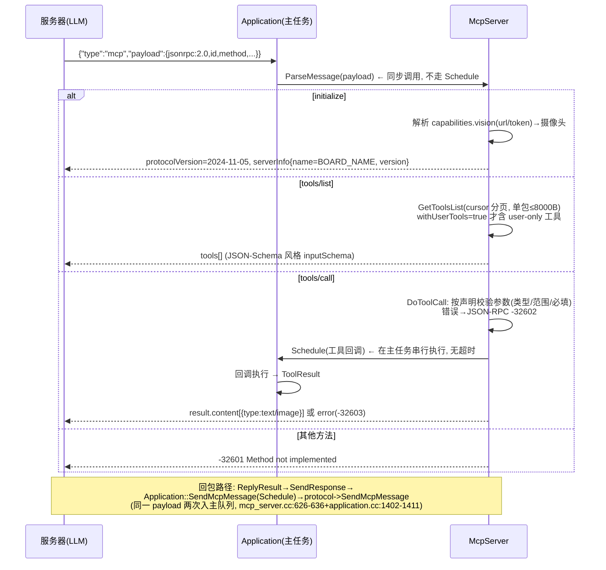

# 09 MCP 工具体系与 Board 接口

## 1. MCP 架构与消息流



- 协议承载：`{"session_id","type":"mcp","payload":<JSON-RPC>}`，WS/MQTT 共用（protocol.cc:102-106）。
- 出站旁路：`mcp_broadcast_callback_` 可把 MCP 消息镜像到本地通道（electron-bot 用法，application.cc:1398-1411）。
- 本地控制面：otto-robot 等板有本地 WebSocket 控制服务直接调 `ParseMessage(payload, sender)`。

## 2. 内置工具清单

**AI 可见（AddCommonTools，mcp_server.cc:29-121）**

| 工具 | 功能 | 条件 |
| --- | --- | --- |
| `self.get_device_status` | 音量/屏幕/电池/网络状态 | 总有 |
| `self.audio_speaker.set_volume` | volume 0-100 | 总有 |
| `self.screen.set_brightness` | brightness 0-100 | 板有背光 |
| `self.screen.set_theme` | light/dark | 有 LVGL 显示 |
| `self.camera.take_photo` | question + 视觉问答（服务器 Explain） | 有相机 |

**仅用户可见（AddUserOnlyTools，annotations.audience=["user"]）**：`self.get_system_info`、`self.reboot`、`self.upgrade_firmware(url)`、`self.screen.get_info`、`self.screen.snapshot(url,quality)`、`self.screen.preview_image(url)`、`self.assets.set_download_url(url)`。

**板级工具示例**：`LampController`（self.lamp.*，boards/common/lamp_controller.h）、`PressToTalkMcpTool`（self.set_press_to_talk）、IR 滤光片（lilygo t-cameraplus-s3）、机器人动作（eda-super-bear）等——板级在 `InitializeTools()` 里注册。

## 3. 工具注册 API（注意两处易错点）

```cpp
// 签名（mcp_server.h:59,433-439）
using ToolCallback = std::function<ToolResult(const PropertyList&)>;
// ToolResult = std::expected<ReturnValue, std::string>
// ReturnValue = std::variant<bool, int, std::string, cJSON*, ImageContent*>
McpServer::GetInstance().AddTool("self.xxx.yyy", "描述", properties, callback);
McpServer::GetInstance().AddUserOnlyTool(...);
```

1. **没有 `PropertyBuilder` 类**——参数声明用 `Property`（bool/int/string；必填/默认值/范围/maxLength，mcp_server.h:63-208）+ `PropertyList`；`operator[]` 查不到的名字直接 abort，解析参数前必须先声明。
2. **无工具级超时、不开线程**：回调经 `Application::Schedule` 在主任务串行执行；长任务（如拍照）用 `TaskPriorityReset` 临时让出 CPU（mcp_server.cc:103-104）。**危险/阻塞操作要自己做校验与超时**——这正是产品化方案"权限策略层"要补的位置。

错误通道约定：参数/未知工具 → JSON-RPC `-32602`；回调返回 `unexpected` → `-32603`；工具失败**不走** `isError:true`。

## 4. Board 基类 API（`main/boards/common/board.h:62-84`）

| 虚函数 | 性质 | 默认 |
| --- | --- | --- |
| `GetBoardType()` | 纯虚 | （WifiBoard 返回 "wifi"） |
| `GetUuid()` | 虚 | NVS `board.uuid`，首启生成 |
| `GetAudioCodec()` | **纯虚** | — |
| `GetNetwork()` / `StartNetwork()` / `GetNetworkStateIcon()` | 纯虚 | 由 WifiBoard/Ml307Board 等网络基类实现 |
| `SetPowerSaveLevel()` / `GetBoardJson()` / `GetDeviceStatusJson()` | 纯虚 | — |
| `GetDisplay()` | 虚 | 静态 `NoDisplay` |
| `GetLed()` | 虚 | 静态 `NoLed` |
| `GetBacklight()` / `GetCamera()` / `GetBatteryLevel()` / `GetTemperature()` | 虚 | nullptr/false（能力可选） |
| `GetSystemInfoJson()` | 虚 | 版本/内存/MAC/UUID/芯片/分区 + `GetBoardJson()` |
| `SetNetworkEventCallback()` | 虚 | 空实现 |

**能力全是可选的**：核心代码调用前必须判空（`GetDisplay()!=nullptr` 等）——裁剪显示/摄像头/电池不破坏核心。

## 5. DECLARE_BOARD 与板卡文件模式

```c
#define DECLARE_BOARD(BOARD_CLASS_NAME) \
void* create_board() { return new BOARD_CLASS_NAME(); }
// board.h:87-90; Board::GetInstance() 调 create_board() 单例化
```

"恰好一个"由构建保证：Kconfig choice 互斥 → CMake 只 GLOB 一个 `BOARD_DIR` → 只有一份 `create_board()`；CMake 另以 WHOLE_ARCHIVE 防链接器丢弃（`main/CMakeLists.txt:1126-1129`）。

典型板目录（`main/boards/bread-compact-wifi/` 为最简范本）：

```
config.h            引脚宏（I2S/I2C/SPI/LED/按键/屏参数）
compact_wifi_board.cc  XxxBoard : WifiBoard
  构造顺序: 按键成员 → InitializeDisplayI2c() → InitializeSsd1306Display()
           （失败降级 NoDisplay）→ InitializeButtons() → InitializeTools()
  GetAudioCodec/GetDisplay/GetLed 用函数内 static 惰性构造
  DECLARE_BOARD(CompactWifiBoard);
config.json         type/manufacturer/target/builds
```

复杂板（esp32-s3-box-3）差异：I2C→SPI→屏（vendor init 命令表）→按键（含 AEC 双击切换）→背光恢复；codec 用 BoxAudioCodec。**网络完全委托基类**，板级不写配网逻辑。

## 6. 新增 MCP 工具的操作序（产品业务扩展路径）

1. 在 `product/mcp/`（建议新增目录）实现工具：名称用 `self.<域>.<动作>`，参数用 `PropertyList` 声明。
2. 回调里：参数校验（PropertyList 已做）→ 权限判断（新增）→ 执行 → 返回 `ToolResult`；长操作加超时与取消。
3. 注册点：板级 `InitializeTools()` 或应用级（`AddCommonTools` 之后，application.cc:109-112）。
4. 按 SKU 启停：注册处包 `#if CONFIG_PRODUCT_XXX` 或运行时开关。
5. 用 `tools/list` 实测确认 JSON-Schema 与分页（单包 8000B 上限）表现正常。
6. 同步更新产品能力清单（方案第九节的元数据要求）。
