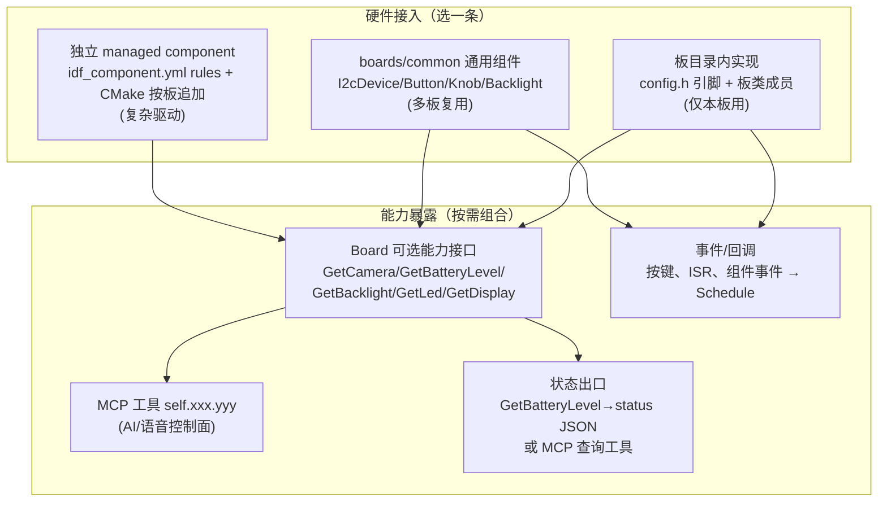
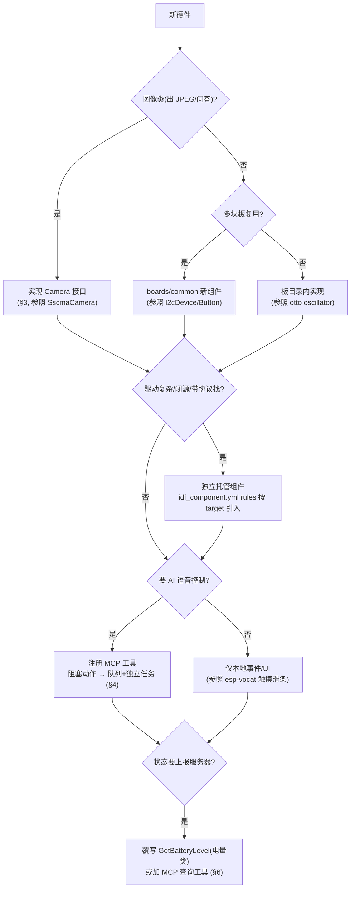
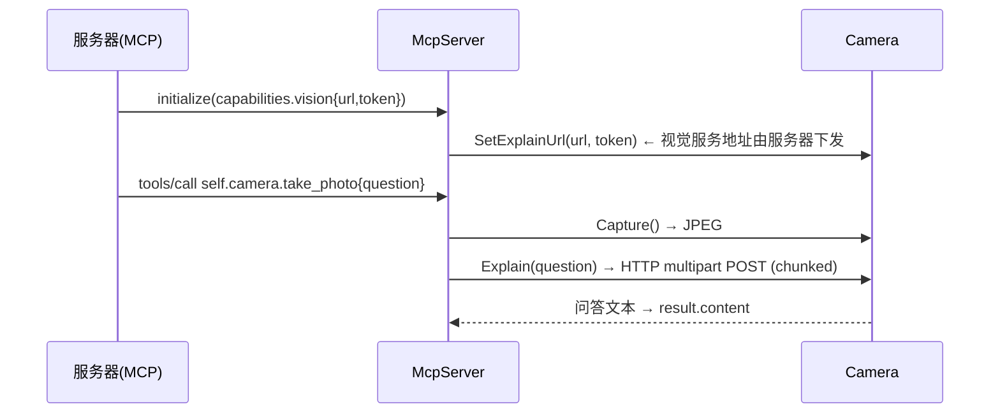
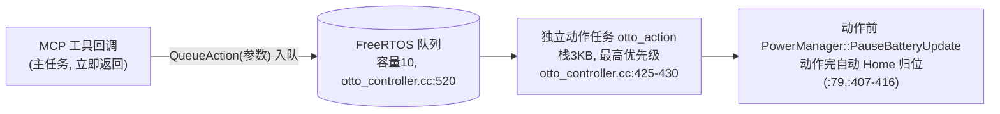

# 10 硬件扩展点（电机 / 摄像头 / 传感器）

> 回答"针对不同硬件怎么加扩展能力"。所有模式都有仓库内实例佐证，附 file:line。

## 1. 扩展点全景



**核心思路**：硬件接入与能力暴露是两件独立的事。驱动可以随便放，但要让"AI 能用它"只有一条路——**注册 MCP 工具**（09 章签名）；要让"服务器状态页看到它"目前只有**覆写 `GetBatteryLevel`** 一条已验证的路（见 §6）。

## 2. 决策流程



## 3. 摄像头扩展

接口（`main/boards/common/camera.h:7-17`，已核对原文）：

```cpp
class Camera {
    virtual void SetExplainUrl(const std::string& url, const std::string& token) = 0;
    virtual bool Capture() = 0;                       // 抓帧并转 JPEG
    virtual bool SetHMirror(bool enabled) = 0;
    virtual bool SetVFlip(bool enabled) = 0;
    virtual bool SetSwapBytes(bool enabled) { return false; }
    virtual std::expected<std::string, std::string> Explain(const std::string& question) = 0;
};
```

现有三种实现证明接口是开放后端：

| 实现 | 后端 | 编译条件 |
| --- | --- | --- |
| `Esp32Camera` | esp32-camera 组件（DVP） | 仅 S3（CMakeLists:1096-1098） |
| `EspVideo` | esp_video（V4L2 风格） | S3/P4/S31（1084-1093），新板推荐 |
| `SscmaCamera` | sscma_client（SPI 协处理器 AI 传感器） | 仅 sensecap-watcher（s3） |

视觉问答链路：



要点：`take_photo` 只在 `GetCamera()!=nullptr` 时注册（mcp_server.cc:92-95）；回调用 `TaskPriorityReset` 临时降主任务优先级（application.h:198-210）。**接新摄像头 = 实现 6 个虚函数 + 覆写 `GetCamera()`，其余全复用。**

## 4. 电机 / 舵机扩展

两种驱动路线（都有实例）：

| 路线 | 实例 | 说明 |
| --- | --- | --- |
| 自写 LEDC PWM（50Hz/13bit） | otto-robot `oscillator.cc:73-160`、electron-bot、eda-super-bear | 零依赖；`Oscillator` 类做正弦摆动，`Otto` 组合多舵机出预定义动作 |
| 托管组件 | esp-hi 用 `espfriends/servo_dog_ctrl`（`esp_hi.cc:316-325` init，`DOG_STATE_*` 动作） | 组件按 target 条件引入（c3） |

**关键工程模式（otto 是范本）**——MCP 回调在主任务串行执行且无超时（09 章），**阻塞式动作绝不能在回调里直接跑**：



配套纪律（实例均实现）：

- **急停工具**：`self.otto.stop`（杀任务+清队列+归位，otto_controller.cc:708-720）。
- **安全限幅**：electron-bot 对单舵机角度按机械范围裁剪（rr=100-180、lr=0-80、b=30-150、h=75-105，electron_bot_controller.cc:487-507）；AI 自编程序列（`servo_sequences`）内置双腿互斥限幅（otto_controller.cc:158-172）。
- **微调持久化**：`set_trim/get_trims` 存 NVS（`Settings("otto_trims")`）。
- **工具命名两种风格**：统一动作工具（`self.otto.action` + action 字符串参数）vs 每动作一个工具（eda-super-bear 的 `self.edarobot.walk_forward` 等）。统一风格对 LLM 更省 token，每动作风格对 prompt 更直白。
- **本地调试复用 MCP**：electron-bot 的本地 WebSocket 把 `type=="mcp"` 消息直接转给 `McpServer::ParseMessage`，并把应答经 `RegisterMcpBroadcastCallback` 广播回调试端（websocket_control_server.cc:151-164、electron_bot.cc:98-102）——桌面调试器和云端 AI 调同一套工具。

## 5. 传感器扩展（实例形态表）

| 传感器 | 板 | 接入形态 | 暴露方式 | 位置 |
| --- | --- | --- | --- | --- |
| IMU bmi270 | esp-spot / esp-vocat | 组件初始化 + 中断（腕势唤醒） | 本地事件（非工具） | esp_spot_board.cc:51-101 |
| 触摸滑条/按键 | esp-vocat | 组件事件回调 + 事件泵任务 | 本地 UI 反馈 | esp_vocat.cc:871-966 |
| NFC GT23SC6699 | zectrix | `I2cDevice` 子类 + 电源脚 + 场检测 ISR + FieldTask | 本地能力（未工具化） | zectrix_nfc.h:21-79 |
| AI 视觉模组 SSCMA | sensecap-watcher | **实现 `Camera` 接口**（SPI 协处理器） | MCP 工具（param_get/set、enable）+ 检测状态机自动触发会话 | sscma_camera.h:27-57, sscma_camera.cc:468-564 |
| 电池（3 种） | 多板 | 覆写 `GetBatteryLevel` | 进标准 status JSON | 见 §6 |

I2C 外设的通用挂载点是 `I2cDevice`（构造 `(i2c_bus, addr)`，提供 `ReadReg/WriteRegs` 等，i2c_device.h:8-19）——ZectrixNfc 与 Xpowers 都是它的子类。传感器给 AI 用就注册 MCP 工具（SSCMA 的 `self.model.*` 是完整范本：参数可选 `-1=不改`、持久化 NVS、enable 开关）。

## 6. 状态上报扩展点

标准状态 JSON 由 `WifiBoard::GetDeviceStatusJson()`（wifi_board.cc:299-340）生成：`audio_speaker.volume / screen.brightness / battery.level / network.type…`；`GetBoardJson()`（:265-277）输出 type/name/manufacturer/ssid/rssi/ip/mac。

- **已验证的出口**：覆写 `GetBatteryLevel(int&,bool&,bool&)`（board.h:80）——数据自动进 status JSON 的 battery 字段。三种电池方案实例：`AdcBatteryMonitor`（构造传分压电阻+充电脚，adc_battery_monitor.h:11-18）、bq27220 库仑计（esp32_s3_touch_lcd_7c.cc:296-312，顺带联动省电定时器）、`Xpowers`（xpower.h:34-75，I2cDevice 桥接 xpowerslib）。
- **无先例**：本仓库没有任何板子覆写 `GetDeviceStatusJson/GetBoardJson`，也没有设备→服务器的主动状态推送通道（上行 JSON 只有 listen/abort/mcp）。机器人姿态等自定义状态目前只能：① MCP 查询工具（`self.otto.get_status` 模式）；② 产品化时新增协议消息（需与服务器协同，见 07 章 §7）。

## 7. 组件依赖接入机制（两处，缺一不可时才都用）

```cmake
# main/CMakeLists.txt:1100-1125（按板/按 target 追加组件）
set(MAIN_PRIV_REQUIRES_EXTRA "")
if(BOARD_TYPE STREQUAL "m5stack-stick-s3")
    list(APPEND MAIN_PRIV_REQUIRES_EXTRA m5stack__m5pm1)
endif()
if(CONFIG_BOARD_TYPE_ESP_SPOT_S3 OR ... )
    list(APPEND MAIN_PRIV_REQUIRES_EXTRA espressif__bmi270_sensor)
endif()
```

```yaml
# main/idf_component.yml（按 target/idf_version 条件引入组件）
espressif/esp32-camera:   { rules: [{ if: "target in [esp32s3]" }] }
espfriends/servo_dog_ctrl: { rules: [{ if: "target in [esp32c3]" }] }
espressif/touch_slider_sensor:
  rules: [{ if: "target in [esp32s3]" }, { if: "idf_version < 6.0.0" }]  # rules 之间是 AND
```

复杂驱动走"托管组件 + 条件引入"，避免无关板卡编译依赖。

## 8. 安全红线（硬件扩展必查）

1. MCP 回调 = 主任务 = 无超时：一切阻塞 I/O/运动序列必须入队到独立任务（§4 模式），急停工具必备。
2. 电机/舵机必须机械限幅 + 上电安全位；AI 可编程序列要加互斥/行程保护（otto 已示范）。
3. 组件/ISR 回调不在主任务：改状态走 `Schedule`（01 章纪律）。
4. 长操作（拍照、上传）用 `TaskPriorityReset` 让出 CPU，别饿死音频任务。
5. 传感器掉电/失联要能降级（构造失败回退 null/NoXxx，参照 display 的降级模式）。

## 9. 新增硬件 Checklist

- [ ] 引脚宏进 `config.h`；不与现板冲突
- [ ] 驱动落位：板目录 / boards/common / 独立组件（按 §2 决策）
- [ ] 组件依赖：idf_component.yml `rules` + CMake `MAIN_PRIV_REQUIRES_EXTRA`（只在需要时）
- [ ] AI 控制面：MCP 工具名 `self.<域>.<动作>`，PropertyList 声明参数与范围
- [ ] 状态面：电量类覆写 `GetBatteryLevel`；其他加查询工具
- [ ] 急停 / 限幅 / 降级三件套
- [ ] 该板 `config.json`、Kconfig、CMake 板条目同步（03 章 §5）
- [ ] 真机验证动作序列 + 长时间运行内存水位
