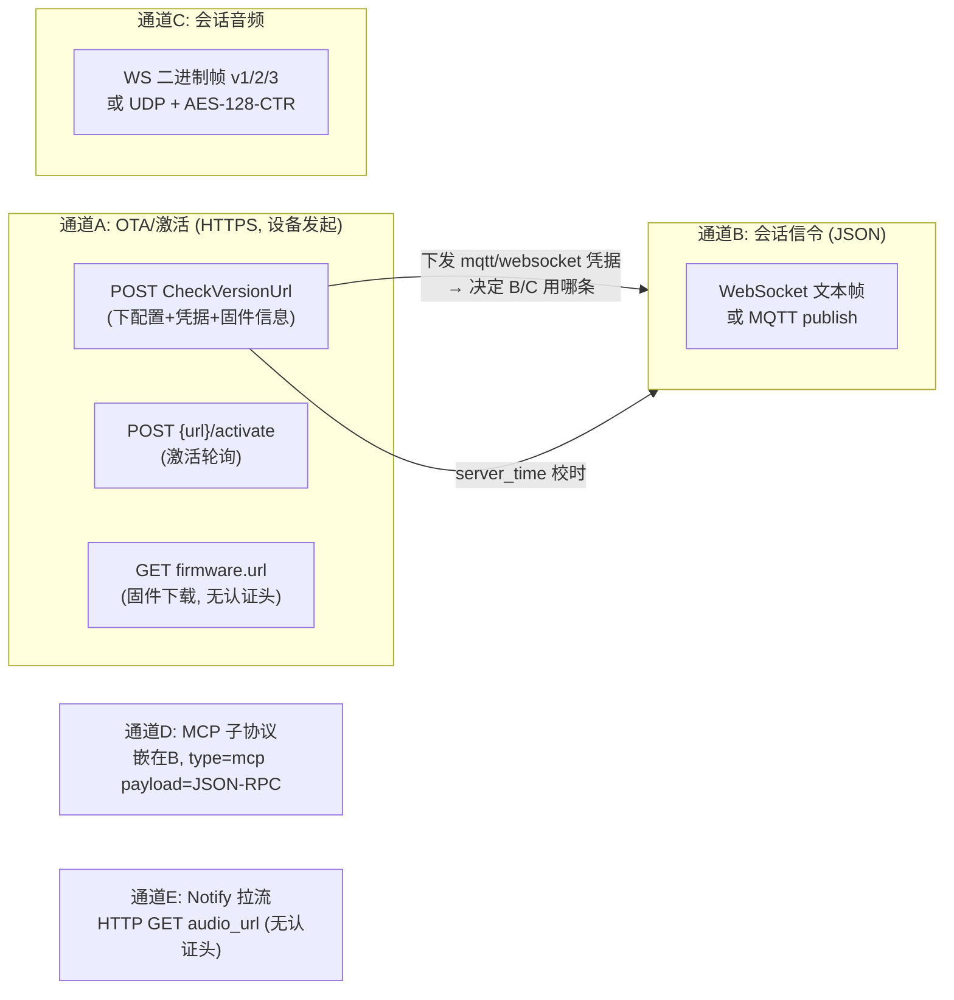

# 11 设备 ↔ 服务端通信协议总规格（wire-level）

> 定位：**服务端实现/对接自查单**。全部字段从固件源码逐行核对（基线 `aab98ab`），运行时行为图见 06/07/09 章。
> 权威参考：上游飞书协议规格（`main/ota.cc:85` 注释链接）与 `docs/websocket.md`、`docs/mqtt-udp.md`、`docs/mcp-protocol.md`。两者与本文冲突时以规格/实测为准。

## 0. 通道总览



| 通道 | 认证凭据 | 凭据来源 |
| --- | --- | --- |
| A OTA/激活 | 头 `Device-Id`(MAC) + `Client-Id`(UUID)；v2 另有 body HMAC | eFuse / NVS，产测烧写 |
| B WS | 头 `Authorization: Bearer <token>` | CheckVersion 响应 `websocket.token` → NVS |
| B MQTT | MQTT username/password + TLS(默认 8883) | CheckVersion 响应 `mqtt.*` → NVS |
| C UDP | 对称 AES-128 key + IV 基值（会话级，随 hello 下发） | server hello `udp{key,nonce}` |
| E Notify | **无设备侧认证头**——URL 需自含签名/短期令牌 | 服务器构造 |

## 1. 通道 A：CheckVersion（配置分发 + 固件检查）

### 1.1 请求

| 项 | 值 | 位置 |
| --- | --- | --- |
| Method | **POST**（body 为系统信息 JSON，恒非空） | ota.cc:103-107 |
| URL | NVS `wifi.ota_url`，为空用 `CONFIG_OTA_URL`（默认 `https://api.tenclass.net/xiaozhi/ota/`） | ota.cc:56-63 |
| `Activation-Version` | `"2"`（eFuse USER_DATA 有可打印序列号）/ `"1"` | ota.cc:70 |
| `Device-Id` | MAC，冒号分隔小写 | ota.cc:71 |
| `Client-Id` | UUIDv4（NVS `board.uuid`） | ota.cc:72 |
| `Serial-Number` | 仅 v2 携带 | ota.cc:73-76 |
| `User-Agent` | `<BOARD_NAME>/<app版本>` | ota.cc:77 |
| `Accept-Language` | 当前语言代码（如 `zh-CN`） | ota.cc:78 |
| `Content-Type` | `application/json` | ota.cc:79 |

**Body 字段字典**（`Board::GetSystemInfoJson()`，board.cc:101-172）：

| 字段 | 类型 | 说明 |
| --- | --- | --- |
| `version` | number | 系统信息 schema 版本，恒为 2 |
| `language` | string | 当前语言代码 |
| `flash_size` | number | 字节 |
| `minimum_free_heap_size` | **string**（源码带引号，服务端需容错） | board.cc:103-104 |
| `mac_address` / `uuid` / `chip_model_name` | string | |
| `chip_info` | object | `{model, cores, revision, features}`（数字） |
| `application` | object | `{name, version, compile_time, idf_version, elf_sha256}` |
| `partition_table` | array | 每项 `{label, type, subtype, address, size}` |
| `ota` | object | `{label}` 运行分区 |
| `display` | object（可选） | `{monochrome, width, height}`，无显示则无此段 |
| `board` | object | `GetBoardJson()`：wifi 板为 `{type, name, manufacturer, ssid, rssi, ip, mac}` |

失败重试：最多 10 次，退避 10s 起每轮倍增（application.cc:456-501）。

### 1.2 响应（200，JSON 五段均**可选**）

| 段 | 字段 | 设备行为 |
| --- | --- | --- |
| `activation` | `message` string（展示用提示语）、`code` string（激活码，**出现即触发激活流程与数字播报**）、`challenge` string（挑战码）、`timeout_ms` number | ota.cc:137-157 |
| `mqtt` | **扁平** string/number 键值对，整体写入 NVS `mqtt`。设备消费的键：`endpoint`(必填, `host[:port]` 缺省端口 8883)、`client_id`、`username`、`password`、`keepalive`(默认 240)、`publish_topic` | 只接受 string/number，**嵌套对象会被忽略**（ota.cc:160-178） |
| `websocket` | 扁平键值对写 NVS `websocket`：`url`(必填)、`token`、`version`(number, 二进制帧版本 1/2/3) | ota.cc:180-199 |
| `server_time` | `timestamp`(毫秒 epoch)、`timezone_offset`?（分钟） | `settimeofday` 校时（缺段仅 WARN） |
| `firmware` | `version`、`url`、`force`(1=强制升级) | 版本比较见 §3 |

**通道选择规则**（application.cc:551-558）：响应含 `mqtt` → MqttProtocol；否则含 `websocket` → WebsocketProtocol；两者皆无 → 告警并回退 MQTT。**服务端二选一下发即可。**

## 2. 通道 A：Activate（激活轮询）

- URL：`CheckVersionUrl + "/activate"`（自动补斜杠，ota.cc:510-515）；请求头同 §1.1。
- Body：v1（无序列号）= `"{}"`；v2 = `{"algorithm":"hmac-sha256","serial_number":…,"challenge":…,"hmac":"<64位hex>"}`，hmac = HMAC-SHA256(eFuse **HMAC_KEY0**, challenge 原文字节)（ota.cc:467-502）。
- 状态码语义：**200 = 激活成功；202 = 等待用户在服务器输入激活码（设备 3s 后重试）；其他 = 失败（设备 10s 后重试）**（ota.cc:532-537、application.cc:527-540）。
- 设备进入激活轮询的条件：响应含 `activation.code` **或** `activation.challenge`（application.cc:515）；而 `Activate()` 调用本身要求 `challenge` 存在（ota.cc:505-508）——**服务端必须在响应中始终携带 challenge**，否则设备每轮立即失败。
- 轮询上限 10 次；期间设备一旦进入 Idle 提前退出。

## 3. 通道 A：固件下发

- `firmware.url` 用**普通 GET，无任何认证头**（ota.cc:293-308）——URL 需自含鉴权（签名/临时令牌）。
- 设备校验：HTTP 200 + Content-Length>0 + app descriptor（image header + segment header + `esp_app_desc_t`）可解析 → 4KB 页流式写 OTA 分区 → `esp_ota_end` 校验 → 切换启动分区（ota.cc:280-406）。
- 版本比较：点分十进制逐段比较；**任一段解析失败则忽略该版本**（防降级/升级死循环，ota.cc:439-465）；`force==1` 无条件升级。
- 回滚：新固件首次 CheckVersion 成功后 `MarkCurrentVersionValid()` 取消 pending-verify（ota.cc:260-278）——服务端发布坏固件会被回滚机制兜底，但升级失败（下载/校验）设备会继续用旧版运行。

## 4. 通道 B/C：WebSocket 会话

### 4.1 握手

| 方向 | 报文 |
| --- | --- |
| 连接 | `GET wss://<websocket.url>`，头：`Authorization: Bearer <token>`、`Protocol-Version: <1\|2\|3>`、`Device-Id`、`Client-Id`（websocket_protocol.cc:97-106） |
| 设备 hello | `{"type":"hello","version":<1\|2\|3>,"features":{"mcp":true[,"aec":true][,"glyph_push":…,"text_font":{…}]},"transport":"websocket","audio_params":{"format":"opus","sample_rate":16000,"channels":1,"frame_duration":60}}`（cc:210-234） |
| 服务器 hello | `{"type":"hello","transport":"websocket"(**必须**，否则拒绝),"session_id":"…","audio_params":{"sample_rate":N,"frame_duration":N}}`（cc:236-263） |
| 超时 | 等 server hello **10s**；120s 无任何入站 → `IsTimeout()`（只影响"通道已开"判定，不主动断） |

### 4.2 二进制帧（`websocket_protocol.cc:24-54,108-140`）

| version | 布局 |
| --- | --- |
| 1 | 裸 Opus 负载 |
| 2 | 16B 大端头：`version u16 / type u16(0=opus) / reserved u32 / timestamp u32(ms, 服务器AEC参考) / payload_size u32` |
| 3 | 4B 头：`type u8 / reserved u8 / payload_size u16(大端)`（无时间戳；接收侧 `type==1` JSON 帧未实现） |

版本由 NVS `websocket.version` 决定（服务器在 CheckVersion 响应里下发，服务端可选）。

### 4.3 JSON 信令

上行（设备→服务器，均带 `session_id`，protocol.cc:66-106）：

| 消息 | 结构 |
| --- | --- |
| listen start | `{"session_id","type":"listen","state":"start","mode":"auto"\|"manual"\|"realtime"}` |
| listen detect | `{"session_id","type":"listen","state":"detect","text":"<唤醒词>"}` |
| listen stop | `{"session_id","type":"listen","state":"stop"}` |
| abort | `{"session_id","type":"abort"[,"reason":"wake_word_detected"]}` |
| mcp | `{"session_id","type":"mcp","payload":<JSON-RPC>}`（见 §6） |

下行（服务器→设备，application.cc:592-736 分发）：

| type | 字段 | 设备行为 |
| --- | --- | --- |
| tts | `state`: `start`/`stop`/`sentence_start`(+`text`,可选 `glyph_push`) | →Speaking；stop→Idle 或自动续听 |
| stt | `text` | 显示用户消息 |
| llm | `emotion` | 表情 |
| mcp | `payload` | §6 |
| notify | `audio_url` 必填 + `subtitles[]` | §7 |
| alert | `status`,`message`,`emotion` 全必填 | 提示+OGG |
| system | `command:"reboot"` | 重启 |
| custom | `payload` | 需 `CONFIG_RECEIVE_CUSTOM_MESSAGE` |

**关键约束**：设备仅在 **Speaking 状态**把下行音频入解码队列（application.cc:567-571）——非 Speaking 态的音频会被静默丢弃，服务器应在 `tts start` 之后再推音频。下行 `audio_params` 驱动设备重采样协商，与设备硬件输出率不一致仅告警（application.cc:573-581）。

## 5. 通道 B/C：MQTT + 加密 UDP 会话

1. **MQTT**（控制面）：`StartMqttClient` 用 NVS `mqtt` 五键连 broker（TLS，keepalive 默认 240s），全部信令走 `publish_topic`。服务器 hello 里 `transport` 必须为 `"udp"`；额外段：
   ```json
   "udp": { "server": "<ip>", "port": N, "key": "<32位hex=16字节>", "nonce": "<32位hex=16字节>" }
   ```
2. **UDP**（音频面）：16B 头 + AES-128-CTR 密文（mqtt_protocol.cc:24-47,210-246）：
   ```
   | type 1B=0x01 | flags 1B | payload_len 2B | ssrc 4B | timestamp 4B | sequence 4B | 密文 |
   ```
   IV 构造：16B `nonce` 为模板，**偏移 2-3 = payload_len(u16 大端)、8-11 = timestamp(u32 大端)、12-15 = sequence(u32 大端，每帧自增)**；接收侧把收到的 16B 头整体作 IV 解密；`sequence <= remote_sequence_` 判重放丢弃（cc:332-364）。`udp.encryption` 字段当前被忽略（cc:456-458，固定假定 AES-CTR）。
3. **goodbye**：客户端主动关闭才发 `{"session_id","type":"goodbye"}`；服务器下发 goodbye（session 匹配）设备直接关通道**不回包**（防 ping-pong，mqtt_protocol.cc:131-143,249-272）。WS 无 goodbye。
4. **重连**：MQTT 控制连接断 → 60s 后且仅 Idle 态重连；keepalive 由 NVS 下发值控制。

## 6. 通道 D：MCP 子协议（嵌在信令通道）

外层 `{"session_id","type":"mcp","payload":<JSON-RPC 2.0>}`，双向同构。JSON-RPC 约束（mcp_server.cc:382-469）：

| 方法 | 请求 params | 设备响应 result |
| --- | --- | --- |
| `initialize` | `{capabilities:{vision:{url,token}}?}` | `{"protocolVersion":"2024-11-05","capabilities":{"tools":{}},"serverInfo":{"name":<BOARD_NAME>,"version":<app版本>}}` |
| `tools/list` | `{cursor?}`, `{"withUserTools":true}` 才返回 user-only 工具 | `{"tools":[{name,description,inputSchema:{type:"object",properties,required},annotations?}],"nextCursor"?}`——**单包 ≤8000 字节，超出用工具名作 nextCursor 分页** |
| `tools/call` | `{name, arguments{...}}` | `{"content":[{"type":"text","text":…}\|{"type":"image","image":{…base64…}}],"isError":false}` |
| 其他 | — | error `-32601` |

错误码：`-32602` 参数缺失/类型错/越界/未知工具；`-32603` 回调返回失败（`unexpected`）；工具失败**不走** `isError:true` 而走 JSON-RPC error。约束：`jsonrpc` 必须为 `"2.0"`、`id` 必须数字、`notifications*` 前缀方法被忽略。工具在**主任务串行执行、无超时**——服务端调用危险工具前应先读 09/10 章的工具清单与安全边界。

## 7. 通道 E：Notify 音频推送

```json
{"type":"notify", "audio_url":"https://…/x.ogg", "subtitles":[{"start_ms":0,"text":"…"}, …]}
```

- 接受条件：设备处于 Idle 且无进行中的通知（application.cc:1182-1226）。
- 设备 HTTP GET `audio_url`（超时 5s，无认证头），要求 **Opus-in-Ogg、单声道、采样率 8/12/16/24/48k**（ogg_demuxer.cc:297-359）；字幕按播放位置（`start_ms`）推进。
- **URL 需自含鉴权**（签名/短期令牌），并注意设备可能处于移动网络。

## 8. 设备生命周期总时序

```mermaid
sequenceDiagram
    participant D as 设备
    participant S as 服务端
    D->>S: ① POST CheckVersion (设备身份头+系统信息)
    S-->>D: ② 五段: activation{code,challenge} + mqtt或websocket + server_time + firmware
    alt 未激活
        D->>D: 播报激活码数字
        loop ≤10 次
            D->>S: ③ POST /activate (v2 带 HMAC)
            S-->>D: 202 → 3s 后重试 / 200 → 成功
        end
    end
    opt firmware 有新版
        D->>S: GET firmware.url (无认证头) → 升级重启
    end
    D->>S: ④ 会话通道握手 (WS: Bearer+hello / MQTT: username+password, hello transport=udp)
    S-->>D: hello{session_id, audio_params[, udp{key,nonce}]}
    loop 会话
        D->>S: 上行: 音频帧 + listen/abort/mcp
        S-->>D: 下行: 音频帧(仅Speaking入队) + tts/stt/llm/mcp/alert
    end
    S--)D: notify{audio_url} → 设备异步 HTTP 拉流播放
    Note over D,S: 120s 无入站仅标记超时; MQTT 断线 60s 后 Idle 态重连; WS 无自动重连
```

## 9. 服务端实现自查清单

- [ ] CheckVersion 返回 **200** + JSON（五段均可选，但激活场景必须含 `activation.challenge`）
- [ ] `mqtt`/`websocket` 段为**扁平** string/number 键值对（嵌套对象会被设备忽略）
- [ ] WS hello 的 `transport` 回 `"websocket"`；MQTT hello 的回 `"udp"`（否则设备拒绝握手）
- [ ] `tts start` 之后才推下行音频；`audio_params` 与设备实际能力匹配（不匹配仅降级重采样）
- [ ] WS 模式：无数据也要考虑应用层保活（设备 120s 只标记不主动断；但 NAT/代理可能掐连接）
- [ ] MQTT 模式：keepalive 值经 `mqtt.keepalive` 下发；goodbye 只该在会话语义关闭时发
- [ ] MCP：先 `initialize`；`tools/list` 支持分页；调用危险工具注意设备端无超时
- [ ] `firmware.url` 与 notify `audio_url` 均为**无认证头**的 GET——URL 自含鉴权
- [ ] 版本号严格 `x.y.z` 点分十进制（含非法段会被设备忽略，导致"永远不升级"）

## 10. 版本兼容矩阵

| 版本字段 | 取值 | 决定方 |
| --- | --- | --- |
| `Activation-Version` 头 | 1 / 2 | 设备 eFuse 有无序列号 |
| WS 二进制帧 version | 1（默认）/ 2 / 3 | 服务器经 `websocket.version` 下发 |
| hello `version` 字段 | WS=帧版本；MQTT 恒 3 | 设备 |
| MCP `protocolVersion` | 恒 `"2024-11-05"` | 设备 |
| 系统信息 `version` | 恒 2 | 设备 |

## 11. 待验证 / 已知差异

1. 服务器实际字段以 `api.tenclass.net` 实测与飞书规格为准；本文是设备端解析视角的完备描述。
2. WS v3 接收侧 `type==1`（JSON 帧）未实现；UDP `udp.encryption` 被忽略；`MQTT_PING_INTERVAL_SECONDS`（mqtt_protocol.h:21）在本仓库无引用。
3. `minimum_free_heap_size` 在 body 中被序列化为字符串（board.cc:103-104，源码如此）——服务端解析需容错。
4. CheckVersion 固定要求 200：3xx 重定向是否跟随取决于 esp-ml307 的 Http 组件，建议服务端避免重定向。
