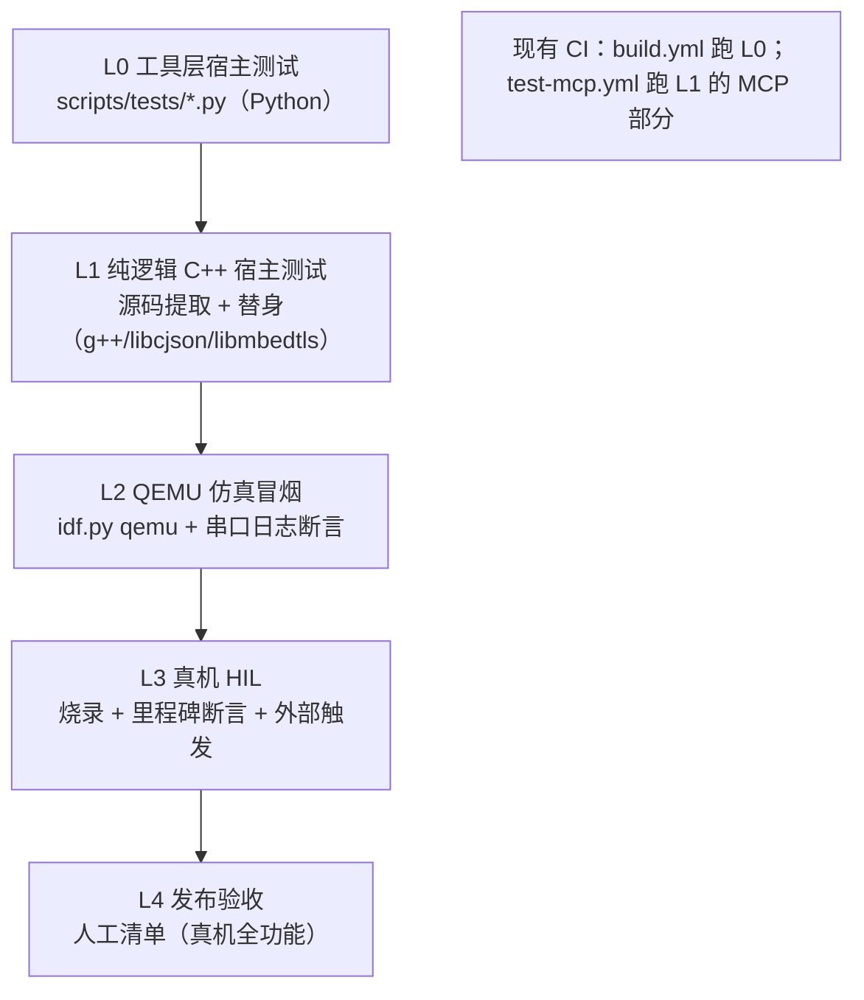

# 13 固件测试指南（单元测试 / 仿真 / 真机）

> 回答"固件项目怎么做单元测试、真机/模拟测试"。基于本仓库**已有**测试资产给出分层方案与扩展路径，不引入新框架。

## 1. 测试分层总览



| 层 | 测什么 | 环境 | 现状 |
| --- | --- | --- | --- |
| L0 | 构建脚本、发布、品牌工具等 Python 逻辑 | 宿主 Python | ✅ 12 个测试文件，CI 必跑 |
| L1 | 固件里**与硬件无关的纯逻辑**（协议/状态机/编解码容器） | 宿主 g++ + libcjson/libmbedtls | 🟡 已有 4 个范例，覆盖面小 |
| L2 | 上电能启动、状态迁移、无崩溃 | QEMU（espressif fork） | ❌ 缺，建议选 C3 板 |
| L3 | 真实射频/音频/唤醒、OTA、功耗 | 真机 + 治具 | ❌ 缺自动化，靠人工 |
| L4 | 全功能回归 | 真机人工 | 🟡 清单已成文（[../baseline-review/](../baseline-review/)） |

## 2. L0 工具层（已建成，规则：改 scripts/ 必带测试）

`python3 -m unittest discover -s scripts/tests -v`，CI 在 build.yml 的 prepare job 自动执行。现有覆盖：build.py 全逻辑、release.py、CI 变体选择、资源打包、MCP 宿主、ogg、品牌工具（brand_audit / check_upstream）。**新增工具脚本一律配套 `scripts/tests/test_<name>.py`**，否则 build.yml 的既有入口不会替你兜底。

## 3. L1：固件 C++ 的宿主单元测试（核心方法）

固件代码不能直接在宿主跑的原因是 FreeRTOS/驱动依赖；本仓库已经形成三种**宿主提取**范式，新测试照范式写即可：

### 3.1 既有三个范式

| 范式 | 例 | 做法 |
| --- | --- | --- |
| 直接编译 + 系统库 | `test_mcp_server.py`（CI：test-mcp.yml apt 装 libcjson/libmbedtls，g++ -std=c++23 编译 `main/mcp_server.cc` + 替身 main） | 模块只依赖 cJSON/字符串/STL |
| 单文件编译 + 驱动喂流 | `test_ogg_demuxer.py` | 纯算法模块，构造字节流断言 |
| 源码切片 + 失败替身 | `test_esp_vocat_i2c.py`（从板级 .cc 抽一个函数编译） | 依赖被隔离在切片外 |
| 真实现 + 渲染替身 | `test_assets.py` | 接口已抽象（Assets） |

### 3.2 什么代码能进 L1（设计判据）

- 无 FreeRTOS API、无寄存器/驱动调用；
- 依赖限定为 cJSON / mbedtls（宿主可装）/ STL；
- **新代码请按此设计**：把纯逻辑与 IO/任务分离。本仓库已留好缝——`Protocol` 的回调注入、`AudioService::callbacks` 结构、`DeviceStateMachine` 的纯函数 `IsValidTransition`，都是天然可测点。

### 3.3 推荐补测目标（按投入产出排序）

| # | 目标 | 源 | 为什么可测 | 建议用例 |
| --- | --- | --- | --- | --- |
| 1 | 状态迁移矩阵 | `device_state_machine.cc` | 纯枚举 + 静态表，零依赖 | 12 状态全合法迁移通过；非法迁移拒绝；`FatalError` 不可迁出；同态 no-op |
| 2 | 版本比较 | `ota.cc` `ParseVersion/IsNewVersionAvailable` | 纯字符串算法 | 正常比较、畸形版本忽略（防降级/死循环）、段数不等 |
| 3 | 协议消息拼装 | `protocol.cc` 五个 Send* | 仅 cJSON | 字段完整、session_id 携带、字符串转义 |
| 4 | 二进制帧打包 | `protocol.h` BinaryProtocol2/3 + `websocket_protocol.cc` | packed 结构 + 大端转换 | v1/2/3 往返一致、payload_size 正确、接收侧边界（<16B 拒绝） |
| 5 | UDP IV 构造与防重放 | `mqtt_protocol.cc` | libmbedtls 宿主带 PSA | IV 偏移 2-3/8-11/12-15 字段正确；`sequence<=remote` 丢弃；解密成功才推进 |
| 6 | 字形载荷校验 | `text_glyph_payload.cc` | 纯 cJSON | 版本必须 1、glyphs≤64、总位图≤64KB 拒绝 |

### 3.4 新增 L1 测试的模板要点（以状态机为例）

```
scripts/tests/test_device_state_machine.py
  1. 定位源文件 main/device_state_machine.cc + .h，检查其 include（预计只有 esp_log——写一个 stub esp_log.h 放进临时目录，-I 优先）
  2. g++ -std=c++20 -c 编译 .cc → .o；再编译测试驱动 main.cpp（构造状态机实例，遍历迁移表断言）
  3. setUpModule 里用 tempfile 建工作目录，tearDown 清理；编译失败要打印 stderr 方便定位
  4. 参照 test_mcp_server.py 的编译/运行封装与 CI 依赖声明
```

CI：纯逻辑测试放 build.yml 既有入口即可自动执行；需要系统库的（如 #5）参照 test-mcp.yml 单开 workflow 或在该测试里跳过缺库环境（`unittest.skipUnless(shutil.which('g++') ...)`）。

### 3.5 IDF 原生 Unity（目标机单元测试）何时用

驱动级代码（I2C codec 读写、Flash/NVS、电源芯片时序）在**真机**上跑 unity 组件测试（`idf.py` 建 test app）。本项目暂不需要：纯逻辑已有宿主模式，驱动层归 L3 HIL 覆盖。不要为了 unity 把业务代码改成双构建体系——收益低、维护重。

## 4. L2：QEMU 仿真冒烟（已落地：Docker 方案）

**已实现**：`bash scripts/qemu/qemu_smoke.sh`——一条命令完成"构建 → QEMU 无头启动 → 里程碑断言"：

- **镜像**：`scripts/qemu/Dockerfile` = `espressif/idf:release-v6.1` + `idf_tools.py install qemu-riscv32`（首次自动构建，约 2GB）。
- **流程**：容器内 `scripts/build.py kevin/c3 --name kevin-c3`（lite 引擎，规避 QEMU 跑不动的 esp-sr/PSRAM 依赖）→ merge-bin 产物 pad 到 4MB 作 mtd 盘 → `qemu-system-riscv32 -M esp32c3` 无头启动 25 秒，串口写 `build/qemu.log` → `hil_smoke.py --from-file build/qemu.log`（与 L3 同一断言核心）。
- **CI**：`.github/workflows/qemu-smoke.yml`（独立工作流，不触碰上游 build.yml）。
- **目标支持**：esp32、esp32c3 成熟；esp32s3 基本可用（外设模型有限）；**esp32p4 不支持**。
- **断言点（无 WiFi 环境下"正确的失败"就是断言）**：

| 里程碑 | 预期日志锚点 |
| --- | --- |
| 启动 | `boot:` bootloader 横幅 |
| 状态机 | `State: starting -> wifi_configuring`（QEMU 无 WiFi 模型，走到配网态=启动链路健康） |
| 稳定性 | 捕获期内无 panic/abort（`hil_smoke.py` 的 panic 正则兜底） |

- **局限**：无 WiFi/蓝牙/音频外设模型，**不能替代真机**；S3/P4 机型的 AFE 路径覆盖不到；esp32/xtensa 需给 Dockerfile 追加 `qemu-xtensa`。

## 5. L3：真机 HIL（硬件在环）

### 5.1 半自动脚本（建议新增 `scripts/hil/hil_smoke.py`）

```
用法: hil_smoke.py --port /dev/ttyUSB0 --board <board> --variant <name> [--skip-flash]
流程: esptool 烧 merged-binary.bin → pyserial 监控 → 里程碑断言（每步超时失败并 dump 最近 200 行）
里程碑: 复位 → 启动横幅(版本号) → 状态迁移 INFO 行 → (注入触发后) Listening/Speaking 迁移 → 无 panic
```

- **触发手段**（按投入从小到大）：① GPIO 治具替人按 BOOT/对话键（继电器或测试板一根线）；② 标准音源对麦克风播放唤醒词（测唤醒链路）；③ 个别板自带的本地 MCP/WebSocket 控制通道。
- **崩溃捕获**：产品 sdkconfig 打开 `CONFIG_ESP_COREDUMP_ENABLE + TO_FLASH`；脚本检测到 panic 后 `espcoredump.py info_corefile` 拉栈回传——售后排查同一通道。
- **零侵入原则**：不给主线代码加"测试模式"分支，用日志锚点 + 外部触发；日志锚点选 INFO 级稳定文案（板名/状态名），避免依赖调试日志。

### 5.2 CI 接入（设备农场）

- self-hosted runner + 标签（如 `[self-hosted, hil-c3]`、`[hil-s3]`）；**只在 `release/*` 分支与手动触发跑 HIL**，普通 PR 不占设备。
- 单设备并发：runner 每设备一个实例（天然串行），或脚本内文件锁。
- L2 与 L3 复用同一个断言脚本，只是"串口来源"不同（QEMU stdout vs 真实 tty）。

### 5.3 自动化的边界（明确测不了）

音频主观质量、射频认证/共存、功耗曲线、真实弱网漫游——保持人工，写进 [../baseline-review/](../baseline-review/) 发布验收清单。

## 6. 差距与路线图

| 阶段 | 内容 | 估时 | 对应方案缺口 |
| --- | --- | --- | --- |
| P0 ✅ | L0 全绿进 CI（含品牌工具） | 已完成 | CI 检查层 |
| P1 | L1 三个目标：状态机矩阵 / 版本比较 / 协议拼装 | 1–2 天 | 核心逻辑回归 |
| P2 | L2 QEMU 冒烟（C3 板 + 断言脚本） | 2–3 天 | 每次提交的启动健康度 |
| P3 | L3 HIL 治具 + hil_smoke.py + 自托管 runner | 3–5 天 | "设备回归"缺口（方案 §9） |

P1 优先做状态机矩阵——它是所有状态相关 bug 的总闸，且实现成本最低（零依赖）。
