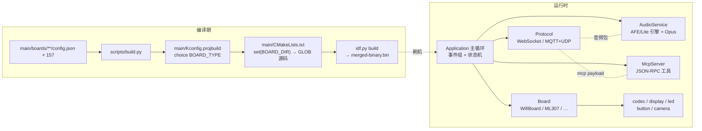

# 小智固件架构文档（面向后续 Agent 的学习手册）

> 基线：上游 `78/xiaozhi-esp32` 提交 `aab98ab`（2026-10-19，当前 `main` 与上游完全一致）。
> 文中所有 `file:line` 均基于该基线；上游同步后引用行号可能漂移，**使用前应按符号名重新检索核对**。
> 性质：对代码现状的描述，不是设计方案。配套的"字段与清单参考"见 [../baseline-review/](../baseline-review/)。

## 文档地图

| 章节 | 内容 | 典型用途 |
| --- | --- | --- |
| [01-overall-architecture.md](01-overall-architecture.md) | 分层结构、任务模型、事件驱动、核心单例 | 建立全局认知 |
| [02-build-pipeline.md](02-build-pipeline.md) | 构建全链路、sdkconfig 合成、变体机制 | 改构建、加变体、查配置 |
| [03-board-identification.md](03-board-identification.md) | 型号判定链路、设备身份、新增板卡清单 | 加板、查"设备是谁" |
| [04-feature-trimming.md](04-feature-trimming.md) | 功能裁剪矩阵：每个开关影响哪些层 | 裁剪功能、控体积 |
| [05-startup-and-state-machine.md](05-startup-and-state-machine.md) | 启动时序、12 状态状态机、主循环 | 排查启动/状态问题 |
| [06-provisioning-and-activation.md](06-provisioning-and-activation.md) | 热点/BluFi 配网、OTA 激活时序 | 改配网、接自有服务端 |
| [07-communication-protocol.md](07-communication-protocol.md) | WebSocket / MQTT+UDP 握手、帧格式、消息全集 | 协议联调、对接服务器 |
| [08-audio-pipeline.md](08-audio-pipeline.md) | 音频数据流、任务与队列、Opus 参数 | 排查音频、调延迟 |
| [09-mcp-and-board-api.md](09-mcp-and-board-api.md) | MCP 工具注册与执行、Board API、DECLARE_BOARD | 加工具、写板卡 |
| [10-hardware-extension-points.md](10-hardware-extension-points.md) | 电机/摄像头/传感器的接入模式与实例 | 加新硬件能力 |
| [11-server-protocol-spec.md](11-server-protocol-spec.md) | 设备↔服务端全部通道的线缆级规格与字段字典 | 服务端实现/协议对接 |
| [12-debranding-customization-plan.md](12-debranding-customization-plan.md) | 去特征化/品牌定制方案（特征盘点+分项改法+审计） | OEM 白标改造 |
| [13-firmware-testing-guide.md](13-firmware-testing-guide.md) | 固件测试分层：宿主单元测试/QEMU 仿真/真机 HIL | 建立测试体系 |
| [FAQ.md](FAQ.md) | 常见疑问速查（数据上报/隐私、换服务器、断线重连等） | 快速答疑 |

## 全景图

## 按任务的阅读路径

| 你要做的事 | 先读 |
| --- | --- |
| 新增板卡 / 变体 | 03 → 09 → [../baseline-review/01](../baseline-review/01-build-system.md) |
| 新增硬件能力（电机/传感器/摄像头） | 10 → 09 → 03 |
| OEM 去特征化 / 品牌定制 | 12 → 04 → 02 |
| 裁剪功能 / 品牌定制 | 04 → 02 |
| 对接自有服务器 / 协议联调 | 11（总规格）→ 07 → 06 |
| 排查音频/唤醒问题 | 08 → 05 |
| 排查状态卡死 / 启动失败 | 05 → 01 |
| 上游同步 | [../baseline-review/04](../baseline-review/04-ci-workflows.md) |

## Agent 必须遵守的硬约束（摘自根目录 AGENTS.md，并经代码证实）

1. 整个固件**恰好一个 `DECLARE_BOARD`**（由 Kconfig choice 互斥 + CMake 单目录 GLOB 保证，见 09 章）。
2. 运行时状态**只能**通过 `Application::SetDeviceState()`（内部为 `DeviceStateMachine::TransitionTo`）变更，非法迁移会被拒绝并告警（`main/device_state_machine.cc:113-136`）。
3. 回调可能运行在任意任务（协议收包、音频回调、定时器）；**修改应用状态必须 `Application::Schedule()`** 投递到主任务（`main/application.cc:1248-1254`）。
4. 不阻塞主循环与音频任务；所有音频队列是定容 `FixedQueue`，满时丢旧或丢弃整批（见 08 章）。
5. 板级差异只放 `main/boards/<板>/`；核心层只依赖 `Board` 抽象接口。
6. 不要手改生成物：`build/`、`managed_components/`、`sdkconfig*`、`main/assets/lang_config.h` 等。

## 事实核对状态

- 本套文档由 8 路只读代码调研汇总而成，关键结论已抽查对照源码（配置数量、Kconfig 选项、状态枚举、协议帧布局、任务创建、宏定义等）。
- 标注"待验证"的条目（esp-ml307/esp-wifi-connect 组件内部、真机行为、服务器实际响应）在联调/构建时需补充确认。
